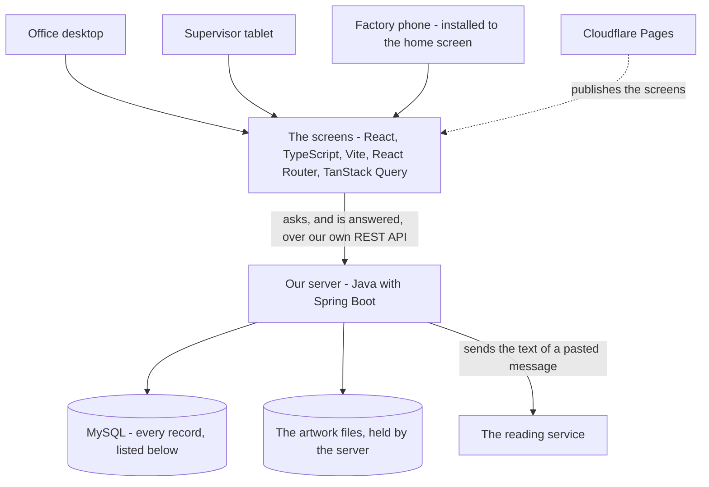
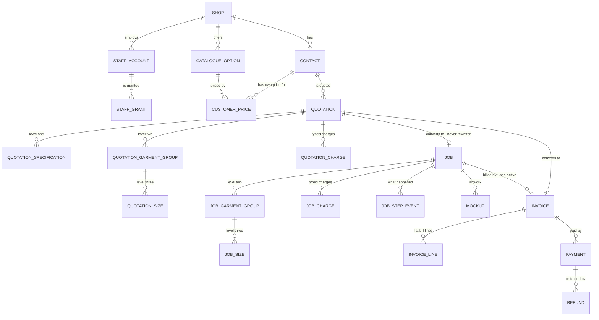

# Software Design Document (SDD)

Project: LLL Print
Status: Draft. It is being rewritten section by section against the agreed SPMP
and SRS, and stays Draft until that is finished and accepted.
Last updated: 2026-10-19

This document says how the system in `docs/SRS.md` is built. The SRS says what
must happen. This says how it is made to happen. Where the two disagree, the SRS
is the requirement and this document is the one that is wrong.

**Where this document stands, 2026-10-19.**

**All nine sections have now been rewritten** against the agreed architecture,
between 2026-10-14 and 2026-10-19. The rewrite that began on 2026-10-14 is
finished. The document stays Draft until the shop accepts it, which is milestone
M3 in SPMP section 3.1.

The architecture every section is now written against is a **server of our own**:
Java with Spring Boot, a REST API of our own, Spring Data JPA, Spring Security,
and MySQL, per SPMP § 2.2, which **rejects a browser talking straight to a hosted
database**. The SRS agrees — NFR-4, SEC-1 to SEC-10 and SEC-9a are all written
around that server.

**No text describing the rejected architecture remains anywhere in this
document**, and every requirement code it cites resolves against `docs/SRS.md`.

Section by section:

| Section | State |
|---|---|
| 1. What this document is for | **Redone.** Corrected to say there are two programs and that the server does not exist yet |
| 2. What the system is made of | **Redone** against SPMP § 2.2: the server, its three layers, what is enforced where, and the two folders the code sits in |
| 3. Module / component breakdown | **Redone.** The five modules, which requirement each covers, and what each delivers. It named a third database and a seventh module; both are gone, along with the customer's own order form |
| 4. Data design | **Redone.** Twenty-five MySQL tables with an ERD, the three levels as three tables, one job record, and the two lists of what MySQL enforces and what the server enforces |
| 5. Who may read and write each record | **Redone.** What the server enforces, read from the signed-in account on every request. One job record, the quotation freeze with its five writable columns, the eleven grants each backed by a rule, and **all eleven security targets cited, SEC-9a included** |
| 6. The screens and the REST API | **Redone.** The five destinations, what every screen must do, the responsive and keyboard checks, how the screens talk to the server, the two rules that stop a double write and a lost edit, every address module by module, the three things that have states, how the money is worked out with the real order's own figures, nineteen checks, and its open points |
| 7. Non-functional design notes | **Redone.** The devices and the connection, money and language and time, keeping it maintainable, and one pointer to section 5. Its own security mapping is gone: it stopped at seven targets where there are eleven, and matched several of them to the wrong rule |
| 8. Out of scope for this design | **Redone** against SRS section 3 and SPMP section 3.1, in two groups — not now but intended, and not intended — plus the one thing that is in scope and only unfinished |
| 9. Open items | **Redone.** Everything genuinely undecided in one table, each line naming who decides it, plus the one item the shop has already settled and the two choices this design made that could have gone the other way |

**What survives, because it is business rule rather than architecture:** the
three levels of an order, three separate stores for quotation, job and invoice,
the typed price per piece, the typed order charge, a material carrying its weight
in its name, and numbers that count up. Those decisions stand; only their
mechanism changes.

## 1. What this document is for

This document answers one question: **how is the system built?** It names what
the system is made of, where each piece of information is kept, what each screen
does, and which rule is enforced where.

| Document | Question it answers |
|---|---|
| SPMP | Why are we building this, what is its scope, and how is the work planned? |
| SRS | Who uses the system, how does an order move through it, and what must happen? |
| SDD | How are the screens, the data and the rules built to meet those requirements? |

### Who reads it

| Reader | What they need from it |
|---|---|
| Whoever builds a module | Section 4 for the data, section 5 for who may touch it, and section 6 for the screens — read before any code for that module is written |
| Whoever reviews finished work | What the module was supposed to do, so the work can be checked against something |
| Whoever picks the project up later | Where each rule is enforced, so a change is made in one place instead of four |

### How it is used

The three documents are agreed first. The system is then built one module at a
time, in the order in SPMP section 3.1. That is SPMP section 2.1, and it is not
repeated here.

**This document is corrected when building proves it wrong.** It is the agreed
starting point, not a frozen contract. When a module shows that something written
here cannot work, the document is changed and the change is recorded.

**Nothing in it is built yet.** There are two programs to build. The screens
exist in an early form — `package.json` has four dependencies, react, react-dom,
react-router-dom and TanStack Query — and that frontend is replaced rather than
extended, kept only as a record of what the screens must not do. **The server
does not exist at all**, not one file of it, and it is written in module 1.

### What it does not cover

| Not here | Where it is |
|---|---|
| Why the system is being built, and its scope | SPMP sections 1 and 2.2 |
| What the system must do | The SRS, as FR-1 to FR-15, NFR-1 to NFR-4, and SEC-1 to SEC-10 plus SEC-9a |
| What the screens look like | The design mockup, which is separate work and is being redone |
| The things deliberately left out | Section 8 |
| What is still undecided | Section 9, and SRS section 6 |

A rule that is already in the SRS is not restated here as though it were a design
decision. Where this document mentions one, it names the requirement and then
says where that requirement is enforced.

## 2. What the system is made of

### There is a server of our own

**The screens run in a browser. Everything else runs on a server of ours.** The
records, the logins, the artwork files, and every decision about who may read or
write anything, are all held and made on that server. The browser asks. The
server decides, and answers.

SPMP section 2.2 is where that choice is argued, with its four reasons and the
options it rejected. This document does not repeat the argument. What it does is
say what follows from it.



Two things in that picture are worth saying out loud.

**The screens have exactly one thing to talk to.** There is no second address.
The browser cannot reach MySQL, cannot reach the artwork files, and cannot reach
the reading service. Everything goes through our own server, which is why there
is one place to enforce a rule instead of several (SEC-1).

**Where the server itself runs is not settled.** While the system is being built,
the server and the database run on the developer's own machine. SPMP section 2.2
lists the hosting as still to be decided, and this document does not invent an
answer. Nothing in the design depends on which machine it turns out to be.

### The parts, named

This table is SPMP section 2.2's choice of tools, with what each one is here to
do. Where the two differ, SPMP section 2.2 is right and this table is wrong.

| Part | What we use | What it does |
|---|---|---|
| The screens | React with TypeScript, built by Vite | Everything the user sees and types |
| Moving between screens | React Router | The destinations in section 6 |
| Asking the server, and holding the answer on screen | TanStack Query | Asking for records, keeping a copy, and knowing when that copy is old |
| Our server | Java with Spring Boot | Holds every record, decides every question of who may do what, and works out every total |
| How the screens talk to the server | A REST API of our own | One address. Section 6 writes down what it offers |
| Reading and writing records | Spring Data JPA | The server's own reading and writing of rows. The screens never see it |
| Where the records are kept | MySQL | Orders, quotations, jobs, invoices, payments, contacts, the option catalogue and its prices, the shop's own details, staff accounts, and the history of each order |
| Login, and who may do what | Spring Security, with a signed token and hashed passwords | Admin and Staff sign in. The customer never does. A password is stored hashed and never in plain text (SEC-6) |
| Where the artwork files are kept | Held by the server, which checks the type and the size | One file per attachment, JPG, PNG or PDF, up to 10 MB (FR-1.12) |
| Reading a pasted customer message | A reading service, called by the server | Turns the text of a message into a proposed order (FR-1.14). The server calls it, so the key for it is never in the browser (SEC-4) |
| Publishing the screens | Cloudflare Pages | Already in use. A workflow builds the screens and publishes the files |
| Opening it from a phone's home screen | A web app manifest and a service worker | NFR-1.3. The factory opens it without a browser bar, and the screens themselves open on a weak signal. Reading an order and saving one still need a connection (NFR-1.3a) |

Money is held in whole sen everywhere. RM 1,734.00 is `173400`, never a
fractional number, so no total can drift by a sen between the quotation and the
invoice (FR-1.8, NFR-2.4). The screens hold it that way, the server works in it,
and MySQL stores it that way.

### The three layers inside the server

SPMP section 2.2 requires that the business rules live in one place on the
server, kept apart from the screens and from the database, so that they can be
reused for another shop rather than rewritten. That makes three layers, and they
are built as three.

| Layer | What it does | What it must never do |
|---|---|---|
| **The part that answers requests** | Picks up each request. Works out who is asking and whether they are allowed it. Takes what was sent, hands it inward, and sends the answer back (SEC-1, SEC-2, SEC-3) | Work out a total. Write a database query. Hold a business rule |
| **The part that holds the rules** | Every total in sen. Every lifecycle rule: what a quotation may become, that an issued invoice cannot be edited, that converting creates a job and an invoice and never touches the quotation (SEC-7, SEC-9a, FR-2.9) | Draw anything. Reach the network. Know that a browser exists |
| **The part that talks to MySQL** | Reads rows and writes rows, through Spring Data JPA | Hold a business rule of any kind. Work out a price |

The middle layer is the one SPMP section 2.2 means by "one place". It draws
nothing and it calls nothing, which is exactly what lets its calculations and its
state changes be tested on their own, with no screen drawn and nothing else
running (NFR-3.2).

Two things cut across all three layers, and each is written once rather than
repeated:

1. **Money is whole sen.** One place turns what was typed into sen, and one place
   turns sen into `RM 1,734.00` for a screen or a document (NFR-2.1, NFR-2.4).
2. **Every record names its shop, and every query names it too.** The shop comes
   from the signed-in account and never from what the browser sent (SEC-2). It is
   applied in one place, so that no single forgotten line can show one shop
   another shop's records. SPMP section 2.2 makes this the first of its three
   rules for serving more than one shop.

### What each part must never do

This is the table the old version of this document did not have, and its absence
is why the same rule ended up written in four places.

| Part | Must never |
|---|---|
| The screens | Decide whether an action is allowed. They may hide a control to keep a screen tidy, and that hiding is never the thing stopping the action (SEC-3) |
| The screens | Hold the only copy of a calculation. Every money figure shown comes from the same rule the server uses to produce the stored one (NFR-3.5) |
| The cache in TanStack Query | Be treated as a second database. It holds a copy of an answer the server gave, and that copy can be out of date |
| Our server | Trust anything the browser says about who it is, which shop it belongs to, or what it may do. All three are read from the signed-in account (SEC-2) |
| Our server | Accept a total it was handed. It works every total out again from the stored lines and refuses one that does not match (SEC-7) |
| MySQL | Be reachable from a browser. Only our server connects to it |
| The reading service | Decide anything. It proposes, and Admin accepts, changes or rejects. It never sets a price (FR-1.14) |
| Cloudflare Pages | Hold a secret. Everything published there can be read by anyone who opens the site (SEC-4) |

### The browser is not trusted

Every request is checked on our server, and nothing is allowed unless something
allows it. A request that arrives with nothing said about who sent it is refused
(SEC-1).

| What the browser sends | What the server does with it |
|---|---|
| Who it says it is | Ignored. The signed-in identity comes from the token the server itself issued and signed |
| Which shop it says the record belongs to | Ignored. The shop is read from the signed-in account. A changed shop field reaches nothing (SEC-2) |
| Which actions it says it may perform | Ignored. The granted actions are read from the staff account record, which that account cannot write to itself (FR-10.5, SEC-3) |
| The totals it sends | Ignored as a source of truth. The server works them out again from the lines it stores, and refuses the request if they do not match (SEC-7) |
| The record it wants to write | Checked for the right shape, the right shop, and a change the record's current state allows (SEC-7) |

So somebody who opens the browser's own developer tools and sends a request
straight at the server gets exactly as far as somebody using our screens, and no
further. That is the point of having the server at all.

### What is enforced where

Every rule is kept in exactly one place. This table says which, so that a change
is made once instead of four times.

| What must hold | Where it is enforced | Why there |
|---|---|---|
| Only a signed-in account acts, and only within its grants | **The server**, in the layer that answers requests | A hidden button stops nobody who knows the address. SEC-1, SEC-2 and SEC-3 all require the check to be on the server |
| Every total matches the lines it came from | **The server**, in the layer that holds the rules | SEC-7 requires the total to be worked out again and the request refused if it does not match. A total calculated in a browser can be changed in that browser |
| An invoice belongs to exactly one job. A payment belongs to exactly one invoice. Neither points at another shop's record | **MySQL itself** | SEC-9 requires the database to refuse a write that breaks one of these, not merely our own code to avoid making one. This is reason 1 in SPMP section 2.2 |
| Converting creates a job and an invoice, and never rewrites the quotation | **The server**, in the layer that holds the rules | No database constraint can express it, which is why SEC-9a exists. Separate tables make it hard to get wrong, and a test proves the quotation is unchanged (FR-2.9) |
| Money is whole sen | **One place on each side**, the screens and the server | Both ends must agree, and the stored value is what the invoice is built from (FR-1.8, NFR-2.4) |
| Every record names its shop | **The server**, in one place, with MySQL refusing a row that names none | Two defences for the rule SPMP section 2.2 puts first, because a single missed query is all it would take |
| A typed order charge is never negative | **The server**, in the layer that holds the rules | FR-1.6a. A negative typed line is the discount FR-1.9 forbids. A thing worth less is a catalogue option priced below zero, which is a different thing |
| The key for the reading service is never in the browser | **The server**, which is the only thing that calls that service | SEC-4. Anything published to Cloudflare Pages can be read by anyone who opens the site |

### A connection is needed for every action

NFR-1.3 and NFR-1.3a settle this, and SPMP section 2.2 says it plainly: the
screens open from the phone's home screen even on a weak signal, but **every
order is read from the server and written to the server.** If the factory loses
signal, a step cannot be marked until it returns. Working offline and catching up
later is out of scope.

**Decided 2026-10-05: nothing is kept on the phone between one opening and the
next.** The choice was put to the shop as three options — reading offline only,
reading and marking offline, or neither — and neither was chosen. So opening the
system with no connection says plainly that there is no connection, rather than
showing yesterday's records as though they were today's.

That still has to be built deliberately rather than assumed, because a screen
changes the instant it is told to, whether or not anything was saved. Three rules
follow, and the first is what makes the other two possible.

1. **A write counts as saved only when the server has answered to say so.** That
   answer is the only thing that counts. A screen changing is not it. The held
   copy agreeing is not it.
2. **Never say saved before that.** A screen says it is saving, and only then that
   it has saved. A message saying "Saved" over a request still in flight is
   something the user will act on.
3. **Never offer a second save because the first one looked lost.** Pressing the
   action again must not be able to make a second record. FR-2.12 requires this of
   the action that makes the job and the invoice, SEC-8 requires it of a payment,
   and SEC-8 also requires that two people editing the same job do not silently
   lose one of the edits. How each one is prevented belongs with the data design
   and with section 5, and is written there rather than here.

And because a lost connection is a normal thing rather than an error to hide,
**the screens shall say so plainly when it happens** (NFR-1.3a), rather than
showing a stale list as though it were current.

These rules exist because the alternative has a known result: a save that looks
lost, pressed again, leaves two records where one was meant. The first write was
never lost. It was waiting.

### Where the code sits

Two programs, in two folders, in one repository. One repository because a single
change often touches both — a typed order charge has to be stored by the server
and typed on a screen — and both halves are then saved together, in one go, so
they cannot fall out of step.

```text
lll-print/
  docs/               the SPMP, the SRS and this document
  web/                program one: the screens
    src/
      app/            routing, providers, putting the application together
      components/
        layout/       the responsive shell and the navigation
        ui/           buttons, fields, tables and dialogs with no business rules
      features/
        catalogue/    the option lists and their standard prices      (module 1)
        orders/       the order form, its three levels, its pricing   (module 1)
        quotations/   the quotation, its document and its link        (module 1)
        reader/       the pasted-message reader                      (module 1, last)
        jobs/         the job, its steps, the factory screen          (modules 2 and 3)
        billing/      the invoice, the deposit, payments, refunds     (module 2)
        handover/     posting out and self-collection                 (module 4)
        contacts/     customer details and their order history        (modules 1 and 4)
        staff/        staff accounts and what each may do             (module 2 onwards)
        shop/         the shop's own details                          (module 1)
        overview/     what needs attention, on one screen             (module 5)
      lib/            money in sen, dates, and the en-MY and RM formatting
      api/            one named operation per thing the server offers
      test/           shared test setup
  server/             program two: the server
    the part that answers requests, one group per thing the API offers
    the part that holds the rules, one group per feature listed above
    the part that talks to MySQL, through Spring Data JPA
    login and permissions, through Spring Security
    the database's own structure, versioned so it can be rebuilt from nothing
```

Inside a feature on either side, keep its screens, its rules and its data access
separately identifiable (NFR-3.1). Do not create an empty folder so that the list
looks organised.

**Nothing in `server/` exists yet.** It is written in module 1, which is why SPMP
section 3.1 says module 1 is larger than it looks: the server, the database, the
login and the permissions are all in it, and none of them is visible on a screen.

**The screens are rebuilt rather than extended.** The React code that exists
today is replaced, and is kept only as a record of what the screens must not do.
It was moved into `web/` on 2026-10-19, so the folder is real and the publishing
workflow already builds from it. Moving it did not make it a starting point: the
rebuilt screens are written in that same folder, replacing what is there.

### Who owns what

| Boundary | Responsibility | Must not own |
|---|---|---|
| `web/src/app/` | Put the routes, the providers and the shell together | Any pricing rule or any lifecycle rule |
| A feature's screens | Draw one task and collect what is typed | Money arithmetic, or calling the server directly |
| `web/src/api/` | The named operations the screens call, one per thing the server offers | Inventing a business rule, or deciding who may do what |
| `web/src/lib/` | Money in sen, dates, and the `en-MY` and RM formatting | Anything belonging to one feature |
| The server's request layer | Who is asking, what they are allowed, and the shape of what was sent | Arithmetic, or a database query |
| The server's rules layer | Pricing, validation and every lifecycle rule, in one place | Drawing anything, or knowing that a browser exists |
| The server's database layer | Reading and writing rows | Any business rule, and any price |
| MySQL | The relations it can enforce, and refusing a write that breaks one (SEC-9) | Working out a total. That is SEC-7, and it belongs to the rules layer |

One file has one job. A screen that mixes a form, arithmetic and a call to the
server is split even when it is short. A file getting long is a reason to look at
it, not a rule by itself.

**Money arithmetic and lifecycle rules are written so they can be tested on their
own**, with nothing else running (NFR-3.2). That is the one boundary worth being
strict about, because it is where a mistake costs the shop money instead of just
looking wrong.

## 3. Module / component breakdown

This section joins two lists together. The SRS says what the system must do, as
FR-1 to FR-15. The plan says the system is built one module at a time, five of
them. This section says **which requirement is built in which module, and what
each module delivers.**

It is a map and nothing more. **When** each module is built is in SPMP section
3.1 and is not repeated here. **Where** the code sits is in section 2 and is not
repeated either.

### The five modules

A module counts as delivered only when it can be opened and used with real typed
data (SPMP section 3.1).

| Module | What it covers | What can be done when it is delivered |
|---|---|---|
| **1. The order form, its prices and the quotation** | FR-12 the option catalogue, FR-1 the order form and its pricing, FR-4 where the order came from, FR-1.14 the pasted-message reader, FR-2.1 to FR-2.4 and FR-2.6 to FR-2.7 the quotation and its link, FR-13 the shop's own details, and the part of FR-9 that adds a customer | A real order is typed and a quotation is produced from it, with a link to send |
| **2. Agreement, job and invoice, deposit and payments** | FR-2.5 the customer agreed, FR-2.8 to FR-2.13 converting, FR-2.10 the deposit, FR-7 the invoice, FR-8 payments and refunds, and FR-10's staff accounts screen | An agreed quotation becomes a job and an invoice, with the balance visible |
| **3. Production** | FR-3 the job, its configurable steps, and the factory's screen on a phone | The factory moves a real job through its steps |
| **4. Sending out, and Contacts** | FR-6 delivery and self-collection, and the rest of FR-9 — the full Contacts screen with search and order history | An order is finished from the first message to handover |
| **5. Overview** | FR-15 the one screen showing what needs attention | The state of every order is readable on one screen |

**The quotation requirement spans two modules, and that is stated rather than
hidden.** Module 1 builds the quotation, its document, its link and its
revisions. Module 2 builds the customer's agreement and everything after it.
FR-2 reads as one requirement because it is one lifecycle, but it is delivered in
two halves.

**Module 5 is last because every line on it reads records the other modules own.**
Built earlier it would be an empty screen (SPMP section 3.1).

### Module 1 carries the foundation

Module 1 is one row in that table and is heavier than every row after it. The
server, the database, logging in and who may do what are all inside it, and
**none of them appears on a screen.** Nothing in `server/` exists yet (section 2).

SPMP section 3.1 says the same thing, and it is repeated here because this is the
section somebody reads to estimate the work.

Module 1 has four showings, in this order:

1. **The option catalogue and its standard prices** (FR-12). First, because the
   order form is made of option buttons and nothing can build a button before
   something decides that the button exists and what it costs.
2. **The order form with its running total** (FR-1, FR-4).
3. **The quotation document and its link** (FR-2.1 to FR-2.4, FR-13).
4. **The pasted-message reader** (FR-1.14). Last, because it is the least
   predictable piece of work in the plan, so the form and the quotation are both
   demonstrable before it starts.

### Written into every module rather than being one of them

Four requirements belong to no single module. Each is built alongside whatever
module needs it, and none is a module of its own.

| Requirement | Why it is not a module |
|---|---|
| FR-5 the activity history | Every module records its own events. Built alone it would have nothing to record; built late it would be missing the earlier modules' history |
| FR-11 using it on a phone | A requirement on every screen as that screen is built, not a thing to be built once |
| FR-14 finding an order | Every list is searchable and filterable. The module that owns the list owns its search |
| FR-10 and NFR-4, who may do what | The checking runs on every request from module 1 onwards (section 5). The screen for managing accounts arrives in module 2, but the enforcement cannot wait for it |

The same is true of NFR-1 to NFR-3. They are properties of everything that is
built, and section 7 holds them.

### What is not a module at all

Three things, said plainly so nobody looks for them.

- **Stock, bill of materials and what a job consumes.** Out of scope, in SRS
  section 3 and SPMP section 3.1. There is no inventory module and none is
  planned in this version.
- **The customer typing their own order.** Admin types every order (FR-1.1), and
  the customer's own form, its private link and its expiry are a later phase. The
  customer never signs in, and the only thing they open is the quotation link
  (section 5).
- **A separate module for logging in, or a module 0.** Logging in is inside
  module 1, with the server it belongs to.

## 4. Data design

This section says where every piece of information is kept, and which rule is
enforced where. It is written against the requirements in `docs/SRS.md` and it
invents nothing that is not needed to meet one of them.

### What shapes this section

**The server decides what each caller is sent.** Three requirements demand that
different people see different parts of the same order:

| Requirement | What it demands |
|---|---|
| FR-3.9a | The factory's step view shows the job title, number, due date, specifications, size quantities, mockup and production notes, and **shall not expose** customer identity, contact details, prices, invoices or payment history |
| FR-10.4 | A production grant shows the factory details for that step "and nothing more" |
| FR-6.3b | A handover grant shows the recipient's name, phone and address, or the pickup location, and **shall not by itself** expose prices, invoice contents or payment history |
| SEC-1, SEC-3 | The server refuses it. A hidden control is never the only thing stopping an action |

All three are met by **what each endpoint returns**. The factory's endpoint
selects the job's title, number, due date, specifications, quantities and
production notes, and does not select the price columns or the customer. An
account without the grant is refused the endpoint outright.

So the data is shaped by what the information **is**, not by who may see it. A
job is one record because a job is one thing. This is worth stating plainly
because the previous version of this section split the job into three records to
hide fields, which a server makes unnecessary.

### Conventions

These hold for every table below without being repeated.

| Convention | Rule |
|---|---|
| **Money** | A whole number of sen, never a fraction (FR-1.8, NFR-2.4). RM 1,734.00 is `173400`. **Every money column's name ends in `_sen`** — `price_per_piece_sen`, `grand_total_sen` — so a money value held the wrong way is visible while reading the code, not only when a total is wrong |
| **The shop** | Every table carries `shop_id`, and every query names it (SPMP section 2.2, FR-12.8, FR-13.5). No exceptions, including history and the numbering table. The server fills it from the signed-in account and never from what the browser sent (SEC-2) |
| **Naming** | `snake_case` for tables and columns, which is what MySQL and Spring Data JPA expect. The API speaks `camelCase`, which is what the screens already use. There is one translation, it happens in one place, and it is the boundary between two things that genuinely have different conventions |
| **Keys** | A generated key on every table, **except where a chosen key buys integrity** — see "What MySQL enforces" |
| **Numbers people read** | A separate column from the key, and they count up: `Q-0001`, `J-0001`, `INV-0001` (D-X) |
| **A moment in time** | Stored in UTC, shown in `Asia/Kuala_Lumpur` (NFR-2.3). Used for "when did this happen" — `uploaded_at`, `occurred_at` |
| **A calendar date** | Stored as a date. Used where the day is the fact and the time of day is meaningless — the date wanted, a validity date, a payment date. A date is not an instant, and storing it as one makes it drift across a timezone |
| **Copied values** | Where a record must keep what was true when it was made, it stores its own copy of the name and the price as well as the key it came from (FR-2.2, FR-7.4, FR-9.4, FR-12.7). The key says where it came from; the copy says what it said |
| **Append-only** | History, step events, payments and refunds are inserted and never updated. A mistake is corrected by a new row that says so, never by changing the old one (FR-5, FR-7.5, FR-8.7) |

### The tables

Twenty-five.

| Group | Tables |
|---|---|
| The shop and its people | `shop`, `staff_account`, `staff_grant` |
| What the shop sells | `catalogue_option`, `customer_price`, `production_step` |
| Customers | `contact` |
| The order and its quotation | `quotation`, `quotation_specification`, `quotation_garment_group`, `quotation_size`, `quotation_charge` |
| The job | `job`, `job_garment_group`, `job_size`, `job_charge`, `job_step_event` |
| Billing | `invoice`, `invoice_line`, `payment`, `refund` |
| The rest | `mockup`, `history_entry`, `document_number`, `reading_usage` |



The picture leaves out `history_entry`, `production_step`, `document_number` and
`reading_usage`, and leaves out the line from `shop` to every other table, so
that it stays readable. Both are in the list above and both are described below.
**Every table carries its shop.**

### The shop and its people

**`shop`** — one row. There will be one for a long time, and that is the point
(SPMP section 2.2, FR-13).

| Column | Note |
|---|---|
| `name`, `registration_number`, `address`, `phone`, `email` | FR-13.1. The registration number is the SSM number, which a Malaysian document needs |
| `logo_path` | Where the logo file is kept |
| `pickup_location` | Used by self-collection without being typed on each order (FR-6.7) |
| `colour_disclaimer` | Optional standing line for the quotation document, for example that a printed colour may differ a little from the mockup. A standing sentence, not a field on an order |

FR-13.4 says changing these shall not alter a document that already exists, so a
quotation and an invoice each keep their own copy of the shop details that were
true when they were made, exactly as they keep the customer's.

**`staff_account`** — FR-10. `name`, `username`, `email`, `password_hash`,
`role` being `admin` or `staff`, and `active`.

**`staff_grant`** — one row per granted action: `staff_account_id` and `action`.
The action is one of the named business actions FR-10.2 lists — see a released
job, attach a mockup, complete a step, skip a step, return to an earlier step,
record that an order was posted, record that it was collected, record a payment,
void a payment, record a refund, maintain the catalogue.

**One row per grant rather than one column per grant.** A new grant is a new row,
not a change to the table's shape, which is what SPMP section 2.2 means by what
differs between shops being data rather than code.

Four things about these two tables matter more than their columns.

1. **A new account has no grant rows at all**, so it can do nothing until Admin
   grants something (FR-10.1).
2. **An account can never write its own grants** (FR-10.5). Only an Admin account
   may write either table. This is what the server reads to decide everything
   else, so an account able to edit it would make every other rule worthless.
3. **The grants are named business actions**, not add, edit and delete (FR-10.2).
4. **`active` is how an account is stopped.** Setting it false stops that account
   everywhere, because the server checks it on every request and refuses a token
   belonging to an inactive account (SEC-6). An account is switched off and never
   deleted, so history keeps pointing at a real account (FR-10.1).

**The password is stored hashed and is never readable** (SEC-6). Nothing in the
system, and no endpoint, returns it.

### What the shop sells

**`catalogue_option`** — one row per option (FR-12.1, FR-12.2).

| Column | Note |
|---|---|
| `kind` | `neck`, `sleeve`, `size`, `material`, `printing_method`, `print_location`, `names_and_numbers`. The lists are kept apart and never merged into a list of combinations (FR-12.1) |
| `name` | As Admin wants it on the button — `Collar Zip`, `EYELAT 170gsm` |
| `standard_price_sen` | May be zero, and may be below zero (FR-1.9, FR-12.2) |
| `charged_per` | `piece` or `order` (FR-1.6) |
| `offered` | `false` stops it appearing on a new order and changes no existing record (FR-12.5) |
| `sort_order` | The order the buttons appear in |

**A material is one option, with its weight in its name.** `EYELAT 170gsm` is one
button, not a cloth plus a weight (D-W). Every button is therefore cloth the shop
actually stocks, and no rule is needed to say which weights go with which cloth.

**`customer_price`** — a price for one customer against one option (FR-12.6).
`contact_id`, `catalogue_option_id`, `price_sen`.

**The pair is unique**, so the database itself makes two prices for the same
customer and option impossible. Used instead of the standard price by FR-1.5.

There is **no** customer price for the price per piece, and no standard one
either. That figure is typed on each order and nothing keeps it (FR-1.4a, D-T).

**`production_step`** — the shop's own steps: `printing_method`, `position`,
`label` (FR-3.7). Sublimation and embroidery do not share a step list, and the
shop sets them itself.

### Customers

**`contact`** — FR-9. `name` required, `phone` and `email` with at least one of
the two required (FR-9.2), `address` optional, and `internal_note`.

**`internal_note` is for the shop only.** FR-9.5 says it never appears on
anything a customer sees, and the endpoint behind the quotation link does not
select it.

FR-9.4 — correcting a contact must not change what earlier records show — is met
by every quotation, job and invoice holding its own copy of the customer details.

### The order and its quotation

**There is no separate order record.** FR-1.10 lets Admin save an unfinished order
and come back to it, and FR-2.1 already gives a quotation a `draft` state. A draft
quotation **is** the order being typed. One record, one thing to find, and the
form's save and the quotation's save are the same write.

**`quotation`** — what is typed once for the whole order.

| Column | Note |
|---|---|
| `number` | `Q-0001` |
| `state` | `draft`, `sent`, `agreed`, `converted`, `cancelled` (FR-2.1) |
| `job_title` | The first thing typed, and the name the order is known by (FR-1.2) |
| `contact_id`, and the customer details copied | The key and the copy |
| The shop details copied | FR-13.4 |
| `date_wanted`, `valid_until` | Calendar dates (FR-1.2, FR-2.3) |
| `price_per_piece_sen` | Typed by Admin. No standard, no customer price, never filled in by the system (FR-1.4a) |
| `source_note` | Where the order came from. Optional, and nothing is refused because it is empty (FR-4) |
| `fulfilment_method` | `delivery` or `collection`. For delivery, the recipient's name, phone, address, postcode and state and the `shipping_charge_sen` Admin set; for collection, the pickup location copied from the shop, which Admin may change for one order (FR-6.6, FR-6.7) |
| `item_subtotal_sen`, `shipping_charge_sen`, `grand_total_sen` | Worked out from the lines, and stored so a document can be reproduced exactly. The server works them out again on every read and every write (SEC-7) |
| `pasted_message` | The customer's message, while this is a draft. See the open points |
| `public_token` | A long random value. The customer's link (SEC-5). See below |
| `sent_at`, `agreed_at` | `agreed_at` is the only thing that marks agreement, because there is no form for the customer to submit (FR-2.5) |
| `cancelled_at`, `cancel_reason` | FR-2.6 requires the reason |
| `revision_of`, `replaced_by` | A sent or agreed quotation is never edited. A change is a new row carrying the earlier one's details, and the two point at each other (FR-2.7) |

**`quotation_specification`** — **level one**, typed once for the whole order
(FR-1.3). One row per specification: `kind` being material, printing method or
print location, the `catalogue_option_id` it came from, and the `name` and
`price_sen` **as they were shown** (FR-2.2).

A table rather than three fixed columns, so that a shop needing a fourth kind of
specification is new rows and not a changed table.

**`quotation_garment_group`** — **level two**. One row per garment group — five
rows on the KEM PENGAKAP order. Its neck and its sleeve, each as a
`catalogue_option_id` plus the copied `name`, `price_sen` and `charged_per`; a
free-text `note` with no price effect, such as `readymade` (D-E); and
`sort_order`.

**`quotation_size`** — **level three**. One row per size entry — twenty rows on
that order. `quotation_garment_group_id`, the size's `catalogue_option_id` plus
its copied `name`, `price_sen` and `charged_per`, a `quantity` above zero, and a
free-text `note` for one piece such as a name or a number.

**`quotation_charge`** — a charge on the whole order, such as artwork setup at
RM 50.00 once. `name` **as Admin typed it**, `amount_sen`, `charged_per`. There
is no catalogue key, because a typed charge does not come from the catalogue
(FR-1.6a, D-Y).

**`amount_sen` is never negative, and MySQL itself refuses one.** Because a charge
is now a row rather than an entry in a list, a check on the column does the work
(FR-1.6a). A negative typed line is the discount FR-1.9 forbids; a thing worth
less stays a catalogue option priced below zero, which is a different thing.

**Why the sizes are their own table under the group.** The real order is five
garments and twenty size entries. Flattened into one list, the garment is
repeated on every row, which is how an order of five garments turns into
seventeen rows that no longer group or price together. With `quotation_size`
pointing at `quotation_garment_group`, **MySQL will not let a size exist without
its group**, so the grouping FR-1.14 requires the reader to keep is held up by
the database rather than by care.

**Everything priced is stored twice over: as the option it came from, and as the
name and price that were shown.** That is what makes FR-12.7 true — changing the
catalogue tomorrow cannot alter what this customer was quoted today.

### The customer's copy, and the link

**There is no second record.** The link carries `quotation.public_token`, a long
random value, and opening it reaches one endpoint that returns the quotation
filtered to what a customer may see: the shop's details, the job title, the
specifications, the garment groups with their sizes and quantities, every priced
line with its arithmetic, the totals and the validity date.

| SEC-5 asks | How it is met |
|---|---|
| The address must be unguessable | A long random token. Counting up from one order to the next reaches nothing, because the token is not the key and bears no relation to `Q-0001` |
| It must expose that one quotation and nothing else | The endpoint takes a token and returns one quotation. There is no way to list, to search, or to reach the customer list or the price list |
| It must be withdrawable | Clearing `public_token` makes the link dead and leaves the quotation itself untouched |

The internal note on the contact, and any note written for Admin, are **not
selected by that endpoint**, which is how FR-2.4's rule that an internal note
never appears is kept.

What stops the customer's copy changing under them is FR-2.7: a sent quotation is
never edited, and a change is a new quotation. The server enforces that, and the
freeze is described under "What converting actually does".

### The job

**One record.** Converting creates it from the quotation, and it then has a life
of its own (FR-3).

| Column | Note |
|---|---|
| `number`, `job_title`, `date_wanted` | FR-3.9a names the job number and the due date |
| `quotation_id` | So the quotation, the job and the invoice stay findable from each other (FR-2.13). **Unique**, so one quotation can produce at most one job |
| The specifications, copied | Material, printing method, print location |
| `total_quantity` | 55 helai on the real order |
| `state` | `awaiting_release`, `in_production`, `production_complete`, `shipped`, `collected`, `cancelled` (FR-3.4) |
| `current_step_position`, `current_step_label` | Where the job is now (FR-3.2) |
| `production_note` | Essential production notes, which FR-3.9a allows |
| `released_by`, `released_at` | Release is Admin's and explicit (FR-3.10) |
| `contact_id`, and the customer details copied | The customer. **Not selected by the factory's endpoint** (FR-3.9a) |
| `price_per_piece_sen`, `item_subtotal_sen`, `shipping_charge_sen`, `grand_total_sen` | Copied from the quotation at convert, then Admin-editable (FR-3.3a). **Not selected by the factory's endpoint** |
| `required_deposit_sen` | From RM 0.00 up to the invoice total, set in the same action, never a percentage and never filled in (FR-2.10, FR-3.13) |
| `active_invoice_id` | At most one active invoice per job (FR-7.7). One column, so a second active invoice cannot exist |
| `fulfilment_method` and the handover details | Recipient name, phone, address, postcode and state, or the pickup location, copied from the quotation. `courier` and `tracking_reference`, both optional, and blank never blocks recording a handover (FR-6.4) |
| `settled` | A plain yes or no, so a handover account can see "not paid yet" without being shown any invoice or payment (FR-6.3b) |
| `handed_over_at`, `handed_over_by`, `unpaid_approval_reason` | One final outcome (FR-6.3a) |
| `cancelled_at`, `cancel_reason` | FR-3.5 requires the reason |
| `version` | Raised once per saved change, so two people editing cannot silently lose one edit (SEC-8) |

**`job_garment_group`** and **`job_size`** — the same two levels as the
quotation, with the same columns, copied at convert. The factory's endpoint
selects the names, the quantities and the notes from them, and does not select
the price columns.

**`job_charge`** — the typed charges, copied, with the same rule that an amount is
never negative.

**`job_step_event`** — inserted and never updated. `job_id`, the step's `label`
and `position` **copied**, `result` being completed, skipped or returned, the
`reason` required for a skip or a return, who acted and when (FR-3.11, FR-3.12).
The label is copied so that renaming or removing a step later cannot rewrite what
already happened (FR-3.8).

### The invoice, payments and refunds

**`invoice`** — FR-7.

| Column | Note |
|---|---|
| `number` | `INV-0001` |
| `job_id`, `quotation_id` | FR-2.13 |
| `contact_id`, the customer details copied, the shop details copied | Its own copies (FR-7.4, FR-13.4) |
| `issued_at`, `due_date` | The due date defaults to the issue date and is never earlier than it (FR-7.6) |
| `item_subtotal_sen`, `shipping_charge_sen`, `grand_total_sen` | Its own copy, exactly as they were at that moment (FR-7.4), and worked out again by the server from the lines below (SEC-7) |
| `required_deposit_sen` | FR-7.4a |
| `lifecycle` | `active` or `superseded`. An issued invoice is never edited or deleted (FR-7.5, FR-7.7) |
| `replaces`, `superseded_by` | The replacement chain. The earlier one stays readable (FR-7.8, FR-7.9) |
| `correction_reason` | Required on a billing-only correction (FR-7.9) |

**`invoice_line`** — the bill, flat (D-AD). `description`, `quantity`,
`unit_price_sen`, `amount_sen`, `sort_order`. The real order becomes a handful of
lines adding to RM 1,734.00 rather than twenty size rows under five groups. The
three levels stay on the quotation and the job, where they are used.

**`payment`** — FR-8. Inserted and never changed. `invoice_id`, `job_id`,
`amount_sen`, `payment_date` as a calendar date, `method` being cash, bank
transfer, e-wallet or other, `method_note` required when other is chosen,
`status` being `recorded` or `voided`, `void_reason`, `voided_at`, and who
recorded it and when.

A payment stays attached to the invoice it was made against, even after that
invoice is superseded, and counts once toward the current balance (FR-7.13).

**`refund`** — FR-8.20 onward. `payment_id`, `amount_sen`, `refund_date`,
`method`, `reference`, `reason`, `status`, and who recorded it.

**The balance is never stored.** It is worked out from the rows each time:

```text
received  = recorded payments - recorded refunds, for this job
total     = the active invoice's total, and only the active one
owing     = total - received, or zero if that is negative
to refund = received - total, or zero if that is negative
```

Storing a balance would give two answers to one question the first time a write
half-succeeded. Nothing writes `owing` anywhere (FR-8.19).

### The rest

**`mockup`** — FR-1.12. The file is held by the server; this row says what it is.
`quotation_id`, `job_id` once one exists, `stored_path`, `file_type` being JPG,
PNG or PDF, `size_bytes`, `uploaded_by`, `uploaded_at`, and `is_current`.

Attaching a new one adds a row and moves `is_current`; the earlier ones stay and
no reason is required. **Nothing anywhere requires one to exist** — not an order,
a quotation, a job, a release or a handover (D-Q, FR-1.11, FR-3.10).

The type and the 10 MB limit are checked **by the server**, which is the only
thing that stores the file, as well as by the screen, because the screen is not
trusted (SEC-1). A refused file loses nothing else that was typed.

**`history_entry`** — FR-5. `subject_type`, `subject_id`, `action`, `actor`,
`occurred_at`, what changed, and the reason where one was required. It covers
everything FR-5.2 and FR-5.4 list. FR-5.3 is honest about what this is worth: it
is only as trustworthy as the login behind it.

**`document_number`** — one row per shop and kind, holding `last_number`.
Reading it, raising it by one, and creating the row that takes the number all
happen **inside one transaction**, so two orders made at the same moment cannot
take `Q-0001` twice and a failure cannot leave a number used by nothing.

Nothing reads this to display anything. If it is ever wrong, the numbers already
given out are what they are — it is not a count of records.

**`reading_usage`** — one row per shop per month, counting how much of the pasted
message reading has been done, so FR-1.14's limit can be enforced and Admin told
when it is reached. The number itself is still unset (SRS section 6).

### What converting actually does

FR-2.8, FR-2.9 and FR-2.12 are the heart of the system, so this is written step by
step. It is **one transaction: either all of it happens or none of it does.**

1. Read the quotation. Stop unless its state is `agreed`, it is the newest
   revision, and no job already points at it (FR-2.5, FR-2.12).
2. Take the next job number and the next invoice number from `document_number`.
3. Insert the `job`, copying the specifications, the customer, the prices, the
   totals, the handover details and the deposit Admin just set.
4. Insert `job_garment_group`, `job_size` and `job_charge` from the quotation's.
5. Insert the `invoice` for the full total, marked `active`, with its
   `invoice_line` rows, and point `job.active_invoice_id` at it.
6. On the quotation, set `state` to `converted`. **Nothing else on the quotation
   is touched.**
7. Insert the history entries.

Afterwards there are **three records the shop can read — the quotation, the job
and the invoice — and the quotation still says exactly what the customer was
quoted**, whatever happens to the job afterwards (FR-2.9, SEC-9a, D-V).

**One place where two requirements read as though they disagree, resolved here.**
FR-2.9 says the quotation "shall not be ... changed by the conversion in any
way", while FR-2.1 lists `converted` as a state a quotation is in and FR-2.13
requires the three records to stay linked. Both cannot be literally true. The
reading this design takes: **what was quoted never changes; where it now stands
does.** So `state` is written, the link is held by `job.quotation_id` and
`invoice.quotation_id` rather than by writing anything onto the quotation, and
every priced field is frozen. If that reading is wrong, FR-2.9 is the requirement
and this document is what must change.

**The freeze is enforced by the server.** Once a quotation is `sent`, the server
accepts a change to `state`, `agreed_at`, `cancelled_at`, `cancel_reason` and
`replaced_by`, and nothing else. Every column holding what the customer was shown
is compared with what is stored and the request refused if it differs. The
quotation's garment groups, sizes, specifications and charges accept no writes at
all once it is sent. This is SEC-9a, and it is the single most important rule in
the system.

**Pressing convert twice cannot make two jobs.** `job.quotation_id` is unique, so
the second attempt is refused by MySQL inside the transaction and nothing is
written (FR-2.12, SEC-8). This is not a rule our code has to remember.

**A payment is different**, because two genuinely identical payments are possible
and so uniqueness cannot come from the contents. Instead the payment form settles
its new row's key **when it opens**, not when it is pressed, so two presses write
the same key twice and the second is refused. One payment (SEC-8).

### What MySQL enforces, and what the server enforces

Both lists matter, and the first one is longer than it would have been under any
other architecture. This is reason 1 in SPMP section 2.2.

**MySQL refuses the write. Our code does not have to remember:**

| Rule | How |
|---|---|
| An invoice belongs to exactly one job, and a payment to exactly one invoice | Foreign keys. A row pointing at nothing cannot be written (SEC-9) |
| Neither points at another shop's record | The shop is part of each of those relations, so a cross-shop link is refused (SEC-9, SEC-2) |
| One quotation produces at most one job | `job.quotation_id` is unique. It is also what makes a second convert impossible (FR-2.12) |
| At most one active invoice per job | `job.active_invoice_id` is one column, so there is one answer |
| One price per customer and option | The pair is unique (FR-12.6) |
| A size cannot exist without its garment group, and a garment group cannot exist without its quotation or job | Foreign keys, which is what holds the three levels of FR-1.3 together |
| A typed charge is never negative | A check on `amount_sen` (FR-1.6a) |
| A quantity is above zero | A check on `quantity` (FR-1.3) |
| A referenced option or contact is never deleted out from under a record | The foreign key refuses it. Stopping an option being offered is a flag, not a deletion (FR-12.5) |
| Either all of a convert happens or none of it does | One transaction |

**The server enforces what no constraint can express:**

| Rule | How |
|---|---|
| Every total matches the lines it came from | The server adds the lines up again on every write and every read and refuses a total that does not match (SEC-7). A total worked out in a browser can be changed in that browser |
| Converting creates a job and an invoice and never rewrites the quotation | The freeze above, and a test that compares the quotation before and after (SEC-9a, FR-2.9) |
| An issued invoice is never edited | The lifecycle rules above (FR-7.5) |
| Who may read and write what, and which shop | Read from the signed-in account on every request (SEC-1, SEC-2, SEC-3) |
| What each caller is sent | Each endpoint selects its own columns. The factory is not sent prices or the customer (FR-3.9a, FR-10.4, FR-6.3b) |
| A second press makes one record, not two | The unique key for a convert; the key settled when the form opens for a payment (SEC-8) |

### Open points in this section

**1. The pasted message, and a proposal before it is accepted.**

This design keeps the pasted text on the **draft** quotation as `pasted_message`,
so Admin can read it again while typing the order, and does not copy it onto the
job or the invoice. It is working material, not part of what was agreed, and
FR-2.2 does not list it among what a quotation saves.

The proposal itself — the garment groups the reading service suggests — is **not
stored at all** before Admin applies it. It stays on screen. FR-1.14 requires
that every proposed value is checked before anything is priced or sent, and
storing an unchecked proposal would mean a half-accepted state existing in the
data for no gain. The cost, stated plainly: closing the browser loses the
proposal, though the pasted text survives if the draft was saved.

**2. Whether the job keeps its own copy of the prices at all.**

FR-3.3 says the job is created from the quotation's resolved prices, totals and
notes, and FR-3.3a lets Admin edit the job's commercial details, which drives a
replacement invoice under FR-7.8. This design puts those columns on the job. The
alternative would be to hold no prices on the job and read them from the active
invoice — fewer copies, but then a commercial job edit has nowhere to live before
the invoice is replaced. The design above is the straightforward reading of
FR-3.3a and is recorded here so the choice is visible rather than assumed.

**3. How the shop's data is got back if the server is lost.**

SEC-10 requires that the data can be restored and that somebody has checked a
restore actually works. With a database of our own this is our responsibility
rather than a provider's, and SPMP section 2.2 lists where the server runs as
still to be decided. **Nothing can be settled here until that is**, and it is
recorded in section 9 rather than guessed at.

## 5. Who may read and write each record

Section 4 said where everything is kept. This says who is allowed to touch it,
and where that is decided.

It turns SEC-1 to SEC-10 and SEC-9a — eleven targets, not ten — from
requirements into the rules that meet them.

### What decides this section

**Every question of who may do what is answered by our own server, on every
request, from the signed-in account.** Nothing the browser says about who it is,
which shop it belongs to, or what it may do is believed (SEC-1, SEC-2).

Our screens hide the controls an account may not use, because FR-10.6 says a
person should see what they may do and FR-11.1 says a phone shows only the parts
that account uses. **That is courtesy, not defence.** A hidden button is never
the only thing stopping an action (SEC-3). Every check below is made again on the
server, and a request sent straight to the server without a screen is refused by
the same rule.

The checks live in the **request layer** described in section 2: who is asking
and what they may do, decided before any rule runs and before any row is read.

### Everything starts from the staff account

The server has to answer two questions before it can answer anything else: who
is asking, and what may they do. The first comes from the signed-in token. The
second is read from the database.

**The token says who, and nothing more.** The role and the grants are read from
the asking account's own `staff_account` and `staff_grant` rows on every single
request, and those rows are the one source of what the account may do.

| | |
|---|---|
| **What it costs** | One small read on every request, by the account's own key. At one shop's volume this is nothing |
| **What it buys** | FR-10.1's switch-off, and an unticked grant, take effect on the **next tap, on every device at once.** There is no issued token still carrying an old answer, and no list of withdrawn tokens to keep |
| **Why it is written down** | The alternative is to put the grants inside the signed token, which saves the read but leaves a token working with the grants it was given until it expires. That is slower to withdraw than SEC-6 asks for |

Three consequences follow, and they decide much of the rest of this section.

1. **`active` is load-bearing, not tidiness.** FR-10.1 lets Admin switch an
   account off. Because the server reads the account on every request, setting
   `active` to false stops that account's next request everywhere at once, and
   the token it still holds is refused (SEC-6). An account is switched off and
   never deleted, so history keeps pointing at a real account.
2. **The staff tables are the keystone.** Only an Admin account may write either
   of them, and no account may ever change its own grants (FR-10.5). This is what
   the server reads to decide everything else. An account able to edit it would
   make every other rule in this document worthless.
3. **Grants are named business actions**, read by name, never as a shape like
   "may edit jobs" (FR-10.2). The shop cares which action was taken, not which
   record was touched.

**A password is stored hashed and is never readable back** (SEC-6). No endpoint
returns it, including to an Admin.

**One setup step that cannot be done from inside the system.** Only an Admin may
create a staff account, so the first Admin account is created once by the
developer, by a one-off command against the database. There is no sign-up screen
and none is in scope (SPMP section 2.2, FR-10.1).

### Nothing is allowed unless something allows it

The server refuses by default. A request reaches a named endpoint, that endpoint
names what it requires, and anything matching nothing is refused rather than
passed through.

**Being signed in is never sufficient on its own.** There is no endpoint whose
only requirement is a valid token (SEC-1). Every one of them requires either the
Admin role or a named grant. The two read-only exceptions are the shop's own
details and the production step list, which every signed-in account of that shop
may read because every screen needs them — stated here as exceptions rather than
left as gaps.

**The shop is decided by the server, not sent by the browser.** Section 4 says
every table carries `shop_id` and that the server fills it from the signed-in
account. The same value is added to every query the server makes. So a request
asking for another shop's record by its identifier finds nothing, and a request
trying to place a record in another shop writes it into its own (SEC-2). There is
no field a browser can set to change this, because the browser never sends it.

**The row limit is applied by the server.** FR-14.4 requires every list to load a
limited number of rows. The server caps what it returns whatever the request
asks for, so a request for everything gets one page.

### Record by record

Read as: what is permitted. Everything not listed is refused. Under FR-1 Admin
types every order in this version, so "Admin" is also who types one.

| Record | Read | Create | Change | Delete |
|---|---|---|---|---|
| `shop` | Any signed-in account of that shop | Nobody — created once at setup | Admin (FR-13.2) | Nobody |
| `staff_account`, `staff_grant` | Admin, and an account may read **its own** | Admin (FR-10.1) | Admin only, never the account itself (FR-10.5) | Nobody — switched off with `active` |
| `catalogue_option` | Any signed-in account of that shop | Admin, or `maintain the catalogue` (FR-12.9) | Same | Refused where any record points at it. Stopping it being offered is a flag (FR-12.5) |
| `customer_price` | Admin | Admin | Admin | Admin |
| `production_step` | Any signed-in account of that shop | Admin, or `maintain the catalogue` | Same (FR-3.7) | Same |
| `contact` | Admin | Admin (FR-9.3) | Admin (FR-9.4) | Refused where any quotation, job or invoice points at it |
| `quotation` and its specifications, groups, sizes and charges | Admin | Admin | **Freely while `draft`. Once `sent`, only the five columns below** | Only while `draft`, never after it has been sent |
| `job`, `job_garment_group`, `job_size`, `job_charge` | Admin; or `see a released job`, **answered with the factory's columns only** | Nobody directly — only inside converting | Admin; or a granted step action, and then only the step columns | Nobody |
| `job_step_event` | Admin, or any production grant | Admin, or the matching step grant | **Nobody. Ever** (FR-3.8) | Nobody |
| `invoice`, `invoice_line` | Admin | Nobody directly — only inside converting or replacing | **Only the lifecycle columns, and only Admin.** Every other column of an issued invoice is refused (FR-7.5) | Nobody |
| `payment` | Admin, or `record a payment` | Admin, or `record a payment` | **Only to void it**, by Admin or `void a payment`, and only if it is not already voided (FR-8.7, FR-8.8) | Nobody |
| `refund` | Admin, or `record a refund` | Admin, or `record a refund` | Only to void it, as above (FR-8.23) | Nobody |
| `mockup` | Admin, or any production grant — the factory must see the mockup (FR-3.9a) | Admin, or `attach a mockup` | Only which one is current | Nobody. Earlier ones stay (FR-1.12) |
| `history_entry` | Admin | The server, as part of the action it records | **Nobody. Ever** (FR-5) | Nobody |
| `document_number` | Nobody reads it to show anything | Only the server, inside the transaction that uses the number | Same | Nobody |
| `reading_usage` | Admin, to see the month's count (FR-1.14) | Only the server | Only the server | Nobody |

**The job's handover columns** are changed by Admin, or by `record that an order
was posted` or `record that it was collected`, and then only those columns.
Approving a handover while money is owed is Admin's alone (FR-6.3a).

Four of those rows deserve spelling out.

### The quotation freeze

This is the single most important rule in the system, because FR-2.9 depends on
it and because the lesson behind FR-2.9 is that losing it is silent.

Section 4 states the rule under "What converting actually does" and this section
does not restate it differently. **Once a quotation is `sent`, the server accepts
a change to `state`, `agreed_at`, `cancelled_at`, `cancel_reason` and
`replaced_by`, and nothing else.** Five columns. Its specifications, garment
groups, sizes and charges accept no writes at all.

So the job title, the customer copied onto it, the specifications, the price per
piece, every garment group, every size, every option price, every typed charge
and every total **cannot be changed after the customer has been sent the
quotation.** Not by a screen with a bug, not by a request sent straight to the
server, not by Admin.

**And the other half, which the earlier version of this section never stated:
converting creates and never rewrites.** It inserts a job and an invoice, each
holding its own key back to the quotation, and writes nothing onto the quotation
but `state`. That is **SEC-9a**, the eleventh target, and the server is what
enforces it because no database constraint can express it. Section 4 gives the
seven steps of the transaction.

Why this matters more than it sounds: a change to a sent quotation is a new
revision (FR-2.7) rather than an edit. The server makes an edit impossible, so
the requirement and the mechanism agree instead of relying on discipline.

### The one thing readable without signing in

The customer's link is the only way into the system without an account, and it
reaches **the quotation itself, filtered by the server** (D-AC). There is no
second record, so the two can never disagree.

| What SEC-5 demands | How it is met |
|---|---|
| The address is unguessable | `quotation.public_token`, a long random value generated by the server, good for exactly one quotation |
| A wrong address finds nothing | The server looks the token up. No match, no answer. Counting up from one order to the next reaches nothing, because the token is not a number |
| It is no route to anything else | **One endpoint, one quotation, no listing.** No request returns many by token, and the endpoint takes no other parameter |
| It exposes only what a customer may see | The endpoint selects the quotation's own lines, totals and the shop's details. It does **not** select the contact's internal note (FR-9.5), the pasted message, or anything about another order |
| It can be withdrawn | Clearing `public_token` kills the link and leaves the quotation untouched |

FR-2.7 — a sent quotation is never edited — is what stops the customer's view
changing under them while they read it.

### What the factory is refused

FR-3.9a and FR-10.4 say a production account sees the factory's details "and
nothing more", and FR-6.3b says the same of a handover account. Section 4 says
how: **each endpoint selects its own columns.**

| The account | What its request is answered with | What it is not sent |
|---|---|---|
| `see a released job`, plus a step grant | The job title, number, date wanted, specifications, size quantities, production notes, step list and mockup | The customer's identity and contact details, every price column, the invoice and the payment history (FR-3.9a, FR-10.4) |
| A handover grant | The recipient's name, phone and address, or the pickup location, and whether money is still owed | Prices, invoice contents and payment history (FR-6.3b) |

**The job is one record and is not split to achieve this.** The earlier version
of this section split it into three records because it had no server, and a
database rule can refuse a whole record but cannot leave one column out of it. A
server leaves the column out. A job is one thing, so it is one record.

**Refused, not hidden.** An account without the grant is refused the endpoint
outright, and an account with it is answered without the columns it may not have.
Neither depends on what a screen draws (SEC-3).

### Every grant, and the rule behind it

SEC-3 requires that every grant in FR-10.2 is checked on the server, so that
removing a button is never the only thing stopping an action. This table is that
check. Eleven grants, eleven rules.

| Grant (FR-10.2) | What the server permits |
|---|---|
| See a released job | Read the job, its steps, its step events and its mockups — the factory's columns only |
| Attach a mockup | Insert a `mockup` row and store the file |
| Complete a production step | Insert a `job_step_event` with a result of `completed`, and move the job's current step |
| Skip a step | The same, with a result of `skipped` **and a reason that is not empty** (FR-3.11) |
| Return to an earlier step | The same, with a result of `returned` and a reason that is not empty |
| Record that an order was posted | Change the job's handover columns to posted |
| Record that it was collected | The same, to collected |
| Record a payment | Insert a `payment` |
| Void a wrong payment | Change one payment's status, with a reason, once (FR-8.7) |
| Record a refund | Insert a `refund` |
| Maintain the option catalogue | Write `catalogue_option` and `production_step` (FR-12.9) |

**A new account holds no grant rows at all**, so it can do none of these until
Admin grants it (FR-10.1).

**The actions that are Admin's and are never grantable** (FR-10.3). Each is
refused to a Staff account by its role, whatever its grants say:

releasing a job (FR-3.10), reopening a finished job for rework (FR-3.12a),
approving a handover while money is owed (FR-6.3a), issuing or replacing an
invoice (FR-7.8), converting an agreed quotation (FR-2.8), setting the deposit
(FR-2.10), the shop's own details (FR-13.2), and staff accounts and their grants
(FR-10.5).

FR-10.3 says a grant never overrides a rule in this document. **A Staff account
with every box ticked still cannot do any of the above**, cannot edit an issued
invoice, cannot change a historical record, and cannot start a job that has not
met its deposit.

**Named actions are the better shape, and the alternative was looked at.** The
other way to do this is a grid of view, add, edit and delete against each module.
It cannot express "release a job to the factory" at all: moving a job along the
steps and declaring an order collected with money still owed are the same tick in
that shape. Named business actions separate them, which is what FR-10.2 asks for.

### The mockup file

The file itself is held by the server, not by the browser (SPMP section 2.2), and
FR-1.12's two limits are checked where they cannot be argued with.

| Check | Rule |
|---|---|
| Who may store one | Admin, or `attach a mockup`, and the file is stored against that account's own shop |
| Type | JPG, PNG or PDF, decided by reading the file rather than by trusting its name |
| Size | 10 MB at most |
| Who may read one | Any signed-in account of that shop, which includes a production account, because the factory must see the mockup (FR-3.9a) |

A file that is too large or the wrong kind is refused by the server even if the
screen's own check is bypassed. **The screen still checks first**, because
FR-1.12 requires the person to be told **which** of the two reasons applies, and
saying so before the upload is kinder than after it.

### Two things the earlier version of this section could not do, and now does

Worth stating because both were written down as permanent limits, and under this
architecture neither is.

1. **Every total is worked out again on the server.** The old version ended by
   conceding that its rules could not do arithmetic, so a wrong total could only
   be noticed afterwards. The server adds the lines up again and **refuses** a
   total that does not match (SEC-7). Section 4 lists this.
2. **A typed charge cannot be negative, and the database refuses it.** The old
   version said a rule could not examine each entry of a list, and withdrew
   section 4's claim on that ground. Section 4 was right. A charge is a row in
   `quotation_charge`, so a check on `amount_sen` settles it (FR-1.6a) — which
   matters because a negative typed charge is the discount FR-1.9 forbids.

### How each target is checked

SEC-1 to SEC-10 and SEC-9a are requirements to be met **before any real customer
data is used**. Every check below is an automated test sent **straight to the
server**, not a reading of the code and not a click through our screens.

| Target | The check |
|---|---|
| SEC-1 | A signed-out request to every endpoint is refused. A signed-in request from an account without the grant is refused. Both sent straight to the server |
| SEC-2 | A request naming another shop's record reaches nothing. A request trying to set a shop field cannot place a record in another shop. The server's own queries are checked to carry the shop |
| SEC-3 | For each of the eleven grants, an account without it is refused by the server. This is the grant table above, turned into eleven tests |
| SEC-4 | The built screens and the repository are searched for keys and passwords. The reading service is confirmed to be called only by the server, never by the browser |
| SEC-5 | A wrong link address finds nothing. There is no request that lists quotations by token. The answer is checked to contain no internal note and nothing of another order |
| SEC-6 | Setting `active` to false refuses that account's next request, on every device. An expired token is refused. The stored password cannot be read back |
| SEC-7 | Requests that try to change a sent quotation's price, edit an issued invoice, change a step event, delete a history entry, skip a state, send a total that does not match its lines, or write a negative quantity are each refused |
| SEC-8 | Pressing convert twice makes one job. Submitting a payment twice from one open form makes one payment. Two accounts changing one job do not silently lose an edit |
| SEC-9 | **The database refuses it, not our code** — one invoice to one job, one payment to one invoice, no cross-shop link, no size without its garment group, no second job from one quotation |
| SEC-9a | **Converting is run, and the quotation is compared column by column before and after.** Nothing in it changed but `state`. The job and the invoice exist and each holds its own key back to it (FR-2.9) |
| SEC-10 | A restore is actually performed and compared against what was there. Not a setting that claims backups exist |

**SEC-10 is the only one of the eleven that no rule and no test can satisfy.** It
requires somebody to restore the shop's data and check it. Until that has
happened once it is not met, and SPMP section 2.2 has not settled where the
server and the database run, so it cannot happen yet. Section 9 carries it as an
open item.

## 6. The screens and the REST API

### What this section is for

This section answers two questions. **What screens are there, and what must each
one do?** And **what does the server offer them?**

It does not repeat what is already settled elsewhere. Section 3 says which module
builds what. Section 4 says where every piece of information is kept. Section 5
says who may read and write each record. Where this section and either of those
disagree, those two are right and this one is wrong.

Three things bind every screen described here.

1. **Admin types every order.** The customer never signs in and never opens a
   form. The one thing a customer opens is the quotation document, by its link
   (FR-1.1, FR-2.4).
2. **A write has happened only when the server says so.** A screen that changes
   is not a saved record (NFR-1.3a).
3. **A screen shows only what the signed-in account may see**, and hiding a
   control is never what enforces that (FR-10.4, SEC-3).

### The five destinations

| Destination | What it is for | What it holds |
|---|---|---|
| Overview | Read the state of the whole shop in one place | Counts and lists grouped by what is waiting to happen, what is running late, and the next action for each row (FR-15) |
| Quotations | Type an order, price it, and turn it into a job | The order form with its running total, the list of quotations, the quotation document and its link, and recording that the customer agreed (FR-1, FR-2) |
| Jobs | See what the factory is working on and move it along | The job list, one job and its production steps, attaching a mockup, and recording that the order went out (FR-3, FR-6) |
| Billing | Find what is owed and record money | Invoices, the balance on each, payments, refunds, and corrections (FR-7, FR-8) |
| More | Reach everything else | Contacts, the option catalogue, Staff accounts, the shop's own details (FR-9, FR-12, FR-10, FR-13) |

**Five destinations and no more.** On a phone they are the bottom navigation,
each with a text label, and the navigation never covers a field, a button or the
information on screen (FR-11.1, FR-11.2). On a desktop and a tablet the same five
are a sidebar. Nothing moves between devices.

**Overview is where reminding happens.** Showing what is late and what is waiting
is a requirement on Overview (FR-15.2, FR-15.3, FR-15.4), not a sixth
destination. Overview never sends anything to a customer (FR-15.6).

**An account sees only the destinations it may use** (FR-11.1). A factory account
granted only production steps sees Jobs and nothing else. The number of things in
the navigation is not fixed.

**No screen is added to this list without being agreed first.**

### What every screen must do

Every screen that reads or writes a record answers to the same table. A screen is
not finished until each row is true of it.

| State | What the screen must do |
|---|---|
| Loading | Show that the affected area is loading. Never show an empty result as though it had loaded |
| Empty | Say that there is nothing, and say whether that is because there are no records at all or because a filter matched none (FR-14.6) |
| Invalid input | Mark the fields, keep what was typed, and move focus to a summary of what is wrong |
| Save failed | Keep what was typed, say what failed, and offer to try again. Never report success before the server has said so |
| Result unknown | Settle the original write by its request identity before letting it be sent again. A greyed-out button is not enough |
| Leaving with unsaved work | Ask whether to discard before moving to another screen |
| Someone else changed it | Say so, show what is there now, and never overwrite the other change silently (SEC-8) |
| Not allowed | Say that the action is unavailable, without showing any part of the record that is being protected (FR-10.4) |
| No connection | Say so plainly, and never appear to have saved something that was not saved (NFR-1.3a) |

**Finding things works the same way on every list** (FR-14).

| What | Rule |
|---|---|
| Search | By order number, customer name and job title. Part of a word matches, and upper and lower case do not matter (FR-14.1, FR-14.2) |
| Filter | By date range and by status. Dates offer at least today, this week, this month and all dates (FR-14.3) |
| How many rows | A limited number at a time, with a way to ask for more (FR-14.4). **The number itself is still to be decided**, and SRS section 6 is where that is recorded. This document does not settle it |
| Whose records | This shop's only, without anyone having to ask for that (FR-14.5, SEC-2) |
| Nothing found | Say so, and say what was searched for (FR-14.6) |
| What is listed | Only rows the signed-in account may see (FR-14.7, FR-10.4) |

**Money on screen is always written as RM.** A dollar sign never appears
(NFR-2.1). A total that is not final is marked as not final, which is what a
quotation in `draft` is (FR-2.1). A quotation past its validity date is shown
plainly as past it, and is not hidden or changed (FR-2.3).

**Returning from a record to its list keeps the list where it was** — the same
filter, the same position — wherever that can be done.

### The responsive and keyboard checks

Every screen is reviewed at these, and a screen that fails one is not finished.

| Check | What is required |
|---|---|
| 320 CSS pixels wide | Everything usable. No page-level sideways scrolling anywhere |
| Tablet, both ways up | Usable in portrait and in landscape |
| Desktop | Usable, and a table is allowed here where everything needed stays visible (NFR-1.7) |
| Phone lists | A readable card or list layout, never a wide table (NFR-1.5) |
| Phone forms | One column, and nothing covering a field or a button (NFR-1.6) |
| The on-screen keyboard | The button being worked towards stays reachable while the keyboard is open |
| Keyboard only | Every action reachable, and the focused thing always visible |
| Names | Every control has a visible label or an accessible name (NFR-1.8) |
| Colour | No status shown by colour alone (NFR-1.8) |
| Zoom | Pinch-to-zoom is never disabled (NFR-1.4) |
| Factory controls | Large enough to hit accurately while standing at a machine (NFR-1.9) |
| Factory actions | Reachable in as few taps as possible from opening the system (FR-11.3) |

These are checks the screens must pass. They are not a claim that the system has
been certified for accessibility.

### How the screens talk to the server

One REST API of our own, served by the Spring Boot server (SPMP section 2.2).
Addresses begin `/api/v1`. Requests and replies are JSON.

| Thing | Rule |
|---|---|
| Money | **Whole sen, as a whole number.** RM 1,734.00 is `173400`. Never a decimal, never a string, never a fractional number (FR-1.8, NFR-2.4) |
| A price that may be below zero | An option's price may be below zero, because that is how a thing worth less is expressed. Kids at minus RM 2.00 is `-200` (FR-1.9, FR-12.2) |
| A price that may not | A typed order charge is never below zero, because a negative typed line would be the discount that is forbidden. MySQL refuses it (FR-1.6a, FR-1.9) |
| Quantities | Whole numbers. Pieces are not divisible. 55 helai is `55` |
| Tax and discount | **There is no tax field and no discount field in any request or reply anywhere in this API** (FR-1.9) |
| Dates | `YYYY-MM-DD`. Times are UTC. The shop's own day is worked out in `Asia/Kuala_Lumpur` (NFR-2.3) |
| Identifiers | Records are identified by their own identifier. Documents also carry their running number — `Q-0001`, `J-0001`, `INV-0001` — which is what a person reads (section 4) |
| Text | Plain text, never markup. Outer spaces are trimmed |

**What the browser never sends.** It never sends a total, a balance, or what it
is owed; the server works every total out again from the stored lines and refuses
one that does not match (SEC-7). It never sends which shop it belongs to, who it
is, or what it is allowed to do; the server reads all three from the signed-in
account on every request (SEC-2, section 5).

**Every request carries the signed token**, and the token says who is asking and
nothing more. The account's grants are read from its own records on every
request, so switching an account off or unticking a grant takes effect on the
next tap (FR-10.1, SEC-6, section 5).

**Lists** take how many rows and a position to carry on from, and reply with the
rows and a position for the next page. The number of rows is the one still to be
decided above.

**When something is refused**, the reply says which of these it was, in a form
the screen can act on rather than only show.

| Refusal | When |
|---|---|
| Not signed in | No valid token |
| Not allowed | Signed in, but the account lacks the grant, or the action is Admin's alone (FR-10.3, FR-10.5) |
| Not found | The record does not exist, or belongs to another shop. The two are answered identically, so nothing is revealed (SEC-2) |
| Invalid | The request is the wrong shape, or a value is out of range. Names the fields |
| Changed by someone else | The record has moved on since it was read (SEC-8) |
| Not possible now | The record is not in a state where this can happen — releasing a job already released, voiding a payment already voided (SEC-7) |
| Already done | The same write has already been settled. See below |
| Too many requests, or temporarily unavailable | The screen may try again |

A refusal never carries another shop's data, a stack trace, or anything about
whether a record exists elsewhere.

### The two rules that stop a double write and a lost edit

Both are SEC-8. They are small and they are not optional.

**A second press must never make a second record.** Every write carries a request
identity, decided by the screen before the request is sent and kept the same on
every retry of that same write. The server settles the write once. The same
identity sent again returns the first result instead of doing it a second time.

Where the record itself can already say "this has happened", the record is what
settles it, and nothing further is needed. Section 4 already provides this in the
two places it matters most:

| Write | What makes it happen only once |
|---|---|
| Turning an agreed quotation into a job and an invoice | `job.quotation_id` is unique. A second attempt is refused by MySQL, not by our code (FR-2.8, SEC-9a) |
| Recording a payment | The request identity settled when the form was opened |

**Two people editing one job must not silently lose an edit.** Every record that
can be edited carries a version, raised once per saved change (section 4). A
screen sends back the version it read. If the record has moved on, the write is
refused and the screen says so and shows what is there now. It never overwrites.

The version belongs to the record being edited. A job's edits raise the job's
version; a billing change raises the billing record's version. A reply to a write
carries the new version, so the screen does not have to read the record again to
make its next change.

### The endpoints, module by module

Every address below begins `/api/v1`. The rules in the previous four
subsections apply to all of them without being repeated: whole sen, whole
quantities, no tax field, no discount field, the signed token, the request
identity on every write, and the version on every edit.

Who may call each one is section 5, not this table. Where a line names a grant,
it is one of the eleven in FR-10.2 and the rule behind it is in section 5. Where
it says Admin only, that is an action no grant ever unlocks (FR-10.3).

**There are no general delete addresses anywhere in this API** — not for a
quotation that has been sent, a job, an invoice, a payment, a refund, or
anything in the production history (FR-5, FR-7.5, FR-8.7).

#### Signing in, and who is signed in

Built in module 1, because nothing else can be saved until it exists.

| Address | What it does |
|---|---|
| `POST /sessions` | Sign in. Replies with the signed token |
| `DELETE /sessions/current` | Sign out. The session ends (SEC-6) |
| `GET /me` | Who is signed in, and every grant that account holds. This is what lets a screen say plainly what the account may do (FR-10.6) |

`GET /me` is read from the account's own records, so an unticked grant shows on
the next screen that asks (FR-10.1).

#### The shop, its people and what it sells

Module 1 builds the catalogue and the steps. Module 2 adds the Staff accounts
screen.

| Address | What it does | Who |
|---|---|---|
| `GET /shop`, `PUT /shop` | The shop's own details, printed on every document (FR-13) | Read: any account. Write: **Admin only** (FR-13.2) |
| `GET /staff-accounts`, `POST /staff-accounts`, `PUT /staff-accounts/{id}` | Create a Staff account, change it, switch it off (FR-10.1) | **Admin only** (FR-10.5) |
| `PUT /staff-accounts/{id}/grants` | Tick and untick each action one at a time (FR-10.2) | **Admin only.** An account can never change its own (FR-10.5) |
| `GET /catalogue-options` | The option buttons, by kind. Takes whether to include ones no longer offered | Any account |
| `POST /catalogue-options`, `PUT /catalogue-options/{id}` | Add an option, change its name or its standard price (FR-12) | Admin, or `maintain the option catalogue` (FR-12.9) |
| `GET /customer-prices`, `PUT /customer-prices` | One customer's own price for one option (FR-12.6) | **Admin only** |
| `GET /production-steps`, `POST /production-steps`, `PUT /production-steps` | The shop's own production steps and their order (FR-3.7) | Admin, or `maintain the option catalogue` |

**No address deletes a catalogue option or a production step.** An option stops
being offered by a flag, and every record that used it stays readable (FR-12.5,
SRS section 6). A step that is removed from the sequence leaves every step event
that already happened untouched, because those events carry their own copy of
the label (FR-3.8).

#### Customers

Module 1 adds a customer while typing an order. Module 4 builds the full screen.

| Address | What it does |
|---|---|
| `GET /contacts` | The list. Searchable and filterable under FR-14 |
| `GET /contacts/{id}` | One customer, and their order history (FR-9.5) |
| `POST /contacts`, `PUT /contacts/{id}` | Add and change (FR-9.3, FR-9.4) |

**These are customers.** There is no kind, type or category on a contact.
Suppliers belong to the stock world, which is out of scope (SRS section 3).

**No address deletes a customer.** One referenced by a quotation, a job or an
invoice is never deleted, and MySQL refuses it anyway (SRS section 6, SEC-9).

Changing a customer's details never rewrites a quotation, a job or an invoice
that has already been made. Each of those holds its own copy (FR-2.2, FR-7.4).

#### The order and its quotation

Module 1, and the four showings in SPMP section 3.1 are built across these.

| Address | What it does | Who |
|---|---|---|
| `GET /quotations` | The list. Filter by state and date range, search by number, customer and job title (FR-14) | Admin, or an account granted a commercial read |
| `GET /quotations/{id}` | One quotation, all three levels, every option with its resolved price, every typed charge, and the totals | Same |
| `POST /quotations` | Start a `draft`. The job title is the first thing typed (FR-1.2) | Admin |
| `PUT /quotations/{id}` | Change it. **Accepted only while `draft`** | Admin |
| `POST /quotations/{id}/send` | `draft` → `sent`. Takes the validity date (FR-2.3). Makes the document and its link, and from here the priced columns are frozen (SEC-9a) | Admin |
| `POST /quotations/{id}/agreed` | `sent` → `agreed`, with the date the customer said yes (FR-2.6) | Admin |
| `POST /quotations/{id}/revisions` | A change to a sent quotation is **a new quotation**, not an edit. The old one is marked replaced and stays readable (FR-2.7) | Admin |
| `POST /quotations/{id}/cancel` | To `cancelled`, from `draft`, `sent` or `agreed`. **A reason is required** (FR-2.1) | Admin |
| `POST /quotations/{id}/convert` | Makes the job and the invoice together, once. Takes the deposit, from RM 0.00 up to the total (FR-2.8, FR-2.10) | **Admin only** |
| `GET /quotations/{id}/history` | Everything that happened to it (FR-5) | Admin, or a granted read |

`POST /quotations` and `PUT` never accept a total. Admin types the price per
piece — there is no standard price and the system never fills one in (FR-1.4a) —
and the server works every total out from the options, the sizes and the typed
charges (SEC-7).

`convert` is the one transaction set out in section 4. Pressing it twice makes
one job, because `job.quotation_id` is unique and MySQL refuses the second
(FR-2.12, SEC-8).

#### The customer's copy of a quotation

| Address | What it does |
|---|---|
| `GET /public/quotations/{token}` | One quotation by its long random link, **readable without signing in** |

This is the only address in the whole API that answers without a token saying
who is asking, and it is D-AC: there is no second stored record. It is the
quotation itself, and the server returns only the columns a customer may see —
the order, the prices, the totals, the shop's own details and the validity date.
It never returns the job, the invoice, any payment, the customer list or
anything about another order.

**There is no address that lists these.** A link reaches exactly one quotation,
and counting up from one order to the next reaches nothing (SEC-5).

A quotation past its validity date still answers, and says plainly that it has
passed. Passing it never deletes or changes anything (FR-2.3).

#### Reading a pasted customer message

Module 1's fourth and last showing.

| Address | What it does |
|---|---|
| `POST /order-drafts/from-message` | Takes the pasted message as **text only**. Replies with a proposal |
| `GET /reading-usage` | How much of the month's reading allowance has been used (FR-1.14) |

The reply is a proposal and **nothing is saved by it** (D-R, FR-1.14). Admin
checks it and it becomes a draft only when Admin saves one.

The proposal keeps the message's own grouping — the real order's five garment
groups, never twenty flat rows — proposes the material and the due date, and
puts `readymade` in the garment group's note with no effect on any price
(D-E, D-R, FR-1.14).

The reading service is called **by the server**, so its key never reaches a
browser (SEC-4). When the month's limit is reached, Admin is told and the order
is still typed by hand (FR-1.14).

#### The mockup and artwork file

| Address | What it does | Who |
|---|---|---|
| `POST /quotations/{id}/mockups`, `POST /jobs/{id}/mockups` | Attach the file. Replies with what is now current | Admin, or `attach a mockup` |
| `GET /quotations/{id}/mockups`, `GET /jobs/{id}/mockups` | What is attached, current one first | Any account of that shop, the factory included (FR-3.9a) |

One file is both the customer's mockup and the print artwork. JPG, PNG or PDF,
10 MB at most, checked by the server as well as by the screen (FR-1.12, D-N).

Attaching a new one never removes the earlier ones, and no reason is required.
**Nothing in this API ever refuses anything because no mockup is attached** —
not an order, a quotation, a convert, a release or a handover (D-Q, FR-1.11,
FR-3.10).

#### The job and its production

Module 2 creates the job. Module 3 builds everything that moves it.

| Address | What it does | Who |
|---|---|---|
| `GET /jobs` | The list. Filter by state and by date wanted, search by number, customer and job title (FR-14) | Admin, or `see a released job` — which is sent the factory's columns only |
| `GET /jobs/{id}` | One job. **What comes back depends on the account**: a production account is sent the garments, sizes, notes, steps and mockups, and is not sent the customer's contact details, any price, any invoice or any payment (FR-3.9a, FR-10.4) | Same |
| `PUT /jobs/{id}` | Change the job. Accepted only while it is not shipped, collected or cancelled. A change to the price or the quantity replaces the invoice in the same action (FR-3.3a, FR-7.8) | **Admin only** |
| `POST /jobs/{id}/release` | `awaiting_release` → `in_production`, at the first step. **Requires an invoice and a met deposit, and never a mockup** (FR-3.10) | **Admin only** |
| `POST /jobs/{id}/steps/current/complete` | Record the current step as completed and move to the next. One tap | Admin, or `complete a production step` |
| `POST /jobs/{id}/steps/current/skip` | Record it as **skipped, not completed**, and move on. **A reason is required** (FR-3.11) | Admin, or `skip a step` |
| `POST /jobs/{id}/steps/current/return` | Go back to an earlier step. **A reason is required** | Admin, or `return to an earlier step` |
| `POST /jobs/{id}/reopen` | A finished job back into production, before it has gone out (FR-3.12a) | **Admin only** |
| `POST /jobs/{id}/handover` | Record that the order was posted or collected (FR-6) | Admin, or `record that an order was posted` / `record that it was collected` |
| `POST /jobs/{id}/cancel` | To `cancelled`. **A reason is required** (FR-3.5) | **Admin only** |
| `GET /jobs/{id}/history` | Everything that happened to it. **Never carries money** (FR-5, FR-10.4) | Admin, or a granted read |

**The step addresses say `current` rather than naming a step**, because a step
action is only ever available on the step the job is actually on (FR-3.12). The
request carries the position the screen believed was current, so an action aimed
at a step the job has already left is refused rather than applied to the wrong
one.

**A step event is inserted and never changed, by anybody** (FR-3.8). There is no
address that edits or removes one.

`handover` says `delivery` or `collection`, which are the two words section 4
uses, and carries the courier and the tracking reference when there are any —
both optional, and leaving them blank never blocks it (FR-6.4). A handover while
money is still owed is **Admin's alone and needs a reason** (FR-6.3a).

A handover account is sent `settled`, a plain yes or no, so it can see "not paid
yet" without being shown any invoice or payment at all (FR-6.3b, FR-10.4).

#### The invoice, payments and refunds

Module 2.

| Address | What it does | Who |
|---|---|---|
| `GET /jobs/{id}/invoices` | Every invoice for the job, the active one and every superseded one (FR-7.8) | Admin, or a granted billing read |
| `GET /invoices/{id}` | One invoice and its flat bill lines (D-AD) | Same |
| `POST /jobs/{id}/invoices/replacement` | Correct an invoice by replacing it. **A reason is required.** The old one becomes superseded and stays readable; it is never edited (FR-7.5, FR-7.9) | **Admin only** |
| `GET /jobs/{id}/balance` | What is owed or what must be refunded, worked out from the rows. **Never stored** (FR-8.19) | Admin, or a granted billing read |
| `GET /jobs/{id}/payments`, `POST /jobs/{id}/payments` | Record money received, against the active invoice. The date may be today or earlier, **never in the future** (SRS section 6) | Admin, or `record a payment` |
| `POST /payments/{id}/void` | Mark one payment as recorded by mistake. **A reason is required**, once, and the original stays visible (FR-8.7, FR-8.8) | Admin, or `void a wrong payment` |
| `GET /jobs/{id}/refunds`, `POST /jobs/{id}/refunds` | Record money already returned outside the system, naming which payment it came from (FR-8.20) | Admin, or `record a refund` |
| `POST /refunds/{id}/void` | The same correction, for a refund recorded by mistake (FR-8.23) | Admin, or `record a refund` with Admin's void rule |
| `POST /jobs/{id}/cancellation-charge` | Confirm the charge agreed with the customer on a cancelled job — which may be the same, less, or nothing (SRS section 6) | **Admin only** |

**There is no address that issues the first invoice.** It is made inside
`convert`, together with the job, from the agreed quotation (FR-2.8, FR-7.4).

**There is no address that edits an issued invoice**, and none that deletes a
payment or a refund. A mistake is corrected by voiding with a reason, which
keeps the original visible and never claims money moved (FR-8.8).

A payment stays attached to the invoice it was made against even after that
invoice is superseded, and counts once toward the current balance (FR-7.13).

Recording a refund **records money already returned**. The system never moves
money and never promises to (FR-8.20).

#### The Overview screen

Module 5, and it reads what every other module owns.

| Address | What it does |
|---|---|
| `GET /overview` | The counts and the lists, grouped by what is waiting to happen, with what is running late marked and the next action named for each row (FR-15) |

One address, because every group is a reading of the same records and the screen
must not show seven different moments in time. It returns counts and lists only,
never figures for a graph (FR-15.5), and only what the signed-in account may see
(FR-15.7). It never sends anything to a customer (FR-15.6).

### The states, and what moves between them

Three things have states. Nothing else does.

#### The quotation

`draft` → `sent` → `agreed` → `converted`, with `cancelled` reachable from
`draft`, `sent` and `agreed`. **No other state exists** (FR-2.1).

| From | Action | To | What it requires |
|---|---|---|---|
| — | Admin starts typing | `draft` | A customer and a job title |
| `draft` | Send | `sent` | A validity date. The document and the link are made, and the priced columns freeze from here (FR-2.3, SEC-9a) |
| `sent` | Record the customer agreed | `agreed` | The date they said yes (FR-2.6) |
| `sent` | Make a revision | this one marked replaced; a **new** quotation in `draft` | A sent quotation is never edited (FR-2.7) |
| `agreed` | Convert | `converted` | Admin, the newest revision, no job already pointing at it, and the deposit set in the same action (FR-2.8, FR-2.12) |
| `draft`, `sent`, `agreed` | Cancel | `cancelled` | A reason (FR-2.1) |

**Converting writes `state` and nothing else on the quotation.** What the
customer was quoted never changes; where it now stands does. That is SEC-9a and
it is the most important rule in the system.

A quotation past its validity date does not change state. It is shown as past it
(FR-2.3).

#### The job

`awaiting_release` → `in_production` → `production_complete` → `shipped` or
`collected`, with `cancelled` reachable before it has gone out (FR-3.4).

| From | Action | To | What it requires |
|---|---|---|---|
| — | Convert | `awaiting_release` | Created with its invoice, in one transaction |
| `awaiting_release` | Release | `in_production`, at the first step | Admin, an invoice, and the deposit **actually received**. **Never a mockup** (FR-3.10) |
| `in_production` | Complete the current step | stays, at the next step | The grant, or Admin |
| `in_production` | Skip the current step | stays, at the next step | The grant, and a reason. Recorded as skipped, not completed (FR-3.11) |
| `in_production` | Return to an earlier step | stays, at that step | The grant, and a reason |
| `in_production` | Complete the last step | `production_complete` | Nothing further. No invoice is issued by finishing (FR-7) |
| `production_complete` | Reopen for rework | `in_production` | **Admin only** (FR-3.12a) |
| `production_complete` | Record posted or collected | `shipped` or `collected` | Fully settled, **or** Admin's approval with a reason (FR-6.3a) |
| Any state before it has gone out | Cancel | `cancelled` | Admin, and a reason (FR-3.5) |

**A shipped or collected job is finished.** Nothing moves it again.

**Money never moves production.** Voiding a payment after release works the
balance out again and may stop a normal handover, but it never reverses, pauses
or undoes anything the factory has already done.

**A step action is only available while the job is in production** (FR-3.12),
and only on the step the job is on.

#### The invoice, the payment and the refund

| Thing | States | Rule |
|---|---|---|
| Invoice | `active`, `superseded` | At most one active per job, because it is one column on the job. An issued invoice is never edited or deleted; it is replaced, and the old one stays readable (FR-7.5, FR-7.7, FR-7.8) |
| Payment | `recorded`, `voided` | Inserted and never changed, except once to void it with a reason (FR-8.7) |
| Refund | `recorded`, `voided` | The same (FR-8.23) |

**What the active invoice shows** is worked out, not stored: unpaid, partially
paid, paid, non-payable, or refund due (FR-8). A zero-value invoice is shown
plainly as not payable.

### How the money is worked out

**No balance is ever stored.** Every figure below is worked out from the rows
each time it is asked for, in whole sen, by the server (FR-8.19, SEC-7).

```text
received   = recorded payments - recorded refunds, for this job
total      = the active invoice's total, and only the active one
owing      = total - received, or zero if that would be negative
to refund  = received - total, or zero if that would be negative

refundable from one payment
           = that payment's amount - the recorded refunds against it
```

Four rules follow from those five lines, and each is enforced by the server.

| Rule | Why |
|---|---|
| A payment above what is owing is refused | Money cannot be received against nothing |
| A refund is refused if it is more than `to refund`, **or** more than is refundable from the payment it names | Both caps apply. One payment cannot be refunded twice over |
| `received` never goes below zero | A refund cannot exceed what came in |
| No request ever supplies a balance | The server works it out. A figure worked out in a browser can be changed in that browser (SEC-7) |

**Worked through on the real order**, which is the example the SRS uses, in RM
and in the sen that are actually stored.

| Step | What happens | total | received | owing | to refund |
|---|---|---|---|---|---|
| 1 | The invoice is made at RM 1,734.00 with a RM 700.00 deposit set | 173400 | 0 | 173400 | 0 |
| 2 | The RM 700.00 deposit is received. The job may now be released | 173400 | 70000 | 103400 | 0 |
| 3 | RM 1,034.00 is received before the order goes out | 173400 | 173400 | 0 | 0 |

**And the corrections the SRS works through, each starting again from step 2**
with RM 700.00 received.

| What Admin does | total | received | owing | to refund |
|---|---|---|---|---|
| Replaces the invoice with RM 1,500.00 | 150000 | 70000 | 80000 | 0 |
| Replaces it with RM 500.00 instead | 50000 | 70000 | 0 | 20000 |
| Then records that RM 200.00 actually went back | 50000 | 50000 | 0 | 0 |
| Cancels instead, and confirms RM 200.00 as the charge agreed | 20000 | 70000 | 0 | 50000 |
| Cancels and agrees a charge of nothing | 0 | 70000 | 0 | 70000 |

The RM 700.00 payment stays attached to the RM 1,734.00 invoice it was made
against in every one of those rows. It is never moved, and it counts once
(FR-7.13).

**Three things this deliberately does not do.** It does not decide whether the
shop may keep a deposit — that is the shop's own commercial matter, and the
system records only the charge agreed. It produces nothing for tax and no credit
note. And it never moves money between one customer's orders or between two
customers (SRS section 6).

**On a superseded invoice's screen**, show what that invoice said and the
receipts made against it, with a way through to the job's current balance. Never
show every past invoice as a separate debt.

**Every screen showing a balance reads the same one.** No screen works out its
own.

### What the screens are checked against

These are checks to be run, not checks already passed. Each one is run on a
phone, a tablet and a desktop.

| Check | What must be true | Requirement |
|---|---|---|
| C-1 The order form and its total | The real order — 55 helai of `EYELAT 170gsm` across five garment groups and twenty size entries, at a typed RM 28.00 a piece, plus its priced options, plus RM 50.00 artwork setup once — reaches **RM 1,734.00**. Every line shows its own arithmetic. **There is no tax field and no discount field to be found anywhere** | FR-1, FR-12 |
| C-2 A price that comes down | An option worth less, such as Kids at minus RM 2.00, lowers the total. A typed order charge below zero is refused | FR-1.9, FR-12.2, FR-1.6a |
| C-3 Send and agree | Sending freezes the priced columns. A change afterwards makes a new quotation and leaves the old one readable | FR-2.3, FR-2.7, SEC-9a |
| C-4 The customer's link | The link opens the quotation without signing in. Changing the link reaches nothing. It gives no route to another order, the customer list or any price list | SEC-5, FR-2.4 |
| C-5 Convert | One press makes one job and one invoice. **A second press makes nothing more.** The quotation is compared before and after and only its state has changed | FR-2.8, FR-2.12, FR-2.9, SEC-8, SEC-9a |
| C-6 Release | Refused with no invoice, and refused with the deposit unmet. **Accepted with no mockup attached.** Accepted with a deposit of RM 0.00 and no payment at all | FR-3.10, FR-1.11 |
| C-7 Production | One tap completes the current step. A skip and a return each demand a reason and are recorded as what they were. Two people tapping at once produce one event. A step the job has left cannot be acted on | FR-3.8, FR-3.11, FR-3.12, SEC-8 |
| C-8 What the factory is not shown | A production account is sent no customer contact details, no price, no invoice and no payment — checked by sending the request straight to the server, not by looking at the screen | FR-3.9a, FR-10.4, SEC-3 |
| C-9 Money | Every row of both tables in the previous subsection. A payment above what is owing, a refund above either cap, and a future-dated payment are all refused | FR-7, FR-8 |
| C-10 Corrections | Replacing an invoice keeps the old one readable and never moves a payment. Voiding keeps the original visible and never claims money moved | FR-7.5, FR-7.8, FR-8.8 |
| C-11 Handover | Refused while money is owed, unless Admin approves it with a reason. A blank courier and tracking reference never block it. A handover account sees only whether money is owed | FR-6.3a, FR-6.3b, FR-6.4 |
| C-12 Finding an order | `kem pengakap` in the wrong case and partly typed finds that order. Date and status filters work on every list. Nothing found says so, and says what was searched for | FR-14 |
| C-13 Overview | Every group in FR-15.2 appears, what is late is marked against the date the customer wants it, and every row names its next action | FR-15 |
| C-14 Screens under strain | Every row of the screen-state table, on every screen that reads or writes: loading, nothing there, bad input, a failed save, an unknown result, leaving with unsaved work, someone else's change, not allowed, and no connection | NFR-1.3a, SEC-8 |
| C-15 Devices and keyboard | Every row of the responsive and keyboard checks. 320 pixels with no sideways scrolling, tablet both ways, keyboard only, and pinch-to-zoom working | NFR-1 |
| C-16 Permissions, sent straight to the server | For each of the eleven grants, an account without it is refused **by the server**, not by a missing button. A signed-out request is refused. Changing the shop or the account in a request reaches nothing | SEC-1, SEC-2, SEC-3, FR-10.2 |
| C-17 Grants take effect at once | Unticking a grant, and switching an account off, both take effect on the next tap, on every device | FR-10.1, SEC-6 |
| C-18 Money is never fractional | No total anywhere drifts by a sen between the order form, the quotation and the invoice. Nothing is held as a fractional number | FR-1.8, NFR-2.4 |
| C-19 Nothing says RM wrongly | A dollar sign appears nowhere on any screen or document | NFR-2.1 |

C-9, C-10, C-18 and parts of C-5 are checks on the server and must be run
against it directly, not through a screen (NFR-3.2).

### Open points in this section

| Open point | What is needed |
|---|---|
| How many rows a list loads at once | Named in SRS section 6 as still to be decided, and deliberately not settled here. Every list address takes it, so only the number is missing |
| What the quotation document actually is | A screen that prints well, or a file the server makes. The SRS requires a document and a link (FR-2.4) and does not say which. This decides whether anything needs to be installed on the server |
| Whether the customer's link ever stops working | FR-2.3 gives the quotation a validity date and requires a passed one to be shown plainly, not hidden. Whether the link itself should refuse to open after some period is not stated anywhere |
| How the Overview groups are counted on a busy month | One address returns every group. Whether that stays fast enough once there are thousands of orders has not been measured, and it is the one place in this API that reads across every module |
| Which addresses the pasted-message reader needs beyond the two above | Settled enough to build module 1's first three showings. Worth revisiting before the fourth is started |
| Minimum browser and device | Named in SRS section 6. Until it is set, the device checks above are run on what the shop actually uses |

## 7. Non-functional design notes

Sections 4, 5 and 6 carry most of what the non-functional requirements ask for.
This section holds the rest: the decisions that do not belong to the data, to who
may touch it, or to a screen.

### The devices, and the connection

NFR-1 is answered by the screens, and section 6 holds the checks each one must
pass. Two things are design decisions rather than screen work.

**Nothing is kept on the phone between one opening and the next.** Decided by the
shop on 2026-10-05, from three choices: reading offline only, reading and marking
offline, or neither. Neither was chosen. So opening the system with no connection
says plainly that there is no connection, rather than showing yesterday's records
as though they were today's (NFR-1.3a, D-U). Section 2 carries the detail.

**A write counts as saved only when the server has answered to say so.** A screen
changing is not it. This has to be built deliberately, because a screen changes
the instant it is told to, whether or not anything reached the server (NFR-1.3a).

**How much is downloaded is not budgeted.** The factory phone fetches the system
over a weak signal, so a budget is worth setting. The Overview screen is counters
and lists rather than graphs, which already keeps a charting library out of the
download (FR-15.5). SPMP section 2.2 lists this as still to be decided, and
section 9 carries it.

### Money, language and time

| Decision | Why |
|---|---|
| Money is held in whole sen everywhere — in MySQL, in the server, and in every request and reply | A fractional number drifts. RM 1,734.00 is 173400 and nothing rounds it twice (FR-1.8, NFR-2.4) |
| Money is turned into text in **one place** on the screens, and in **one place** on the server for documents | Two places would eventually disagree, and NFR-2.1 forbids a dollar sign anywhere |
| The language and region are `en-MY` | NFR-2.2 |
| Times are stored as the moment they happened and shown in `Asia/Kuala_Lumpur` | A date the shop reads is the shop's own day. Storing the moment and converting on the way out means a server moved elsewhere changes nothing (NFR-2.3) |
| A date the customer chose — the date they want the order by, a payment's date, an invoice's due date — is a plain calendar date, not a moment | 5 October is 5 October whatever the time was |

### Keeping it maintainable

Section 2 sets out the three layers inside the server and what each must never
do. Four notes follow from NFR-3.

**Money and lifecycle rules are testable on their own**, without drawing a page
and without starting the server (NFR-3.2). That is why the balance arithmetic in
section 6 is written as five lines over the stored rows: it can be run against
figures alone. The worked example from the real order is the test data.

**A price rule lives in one place, and that place is the server** (NFR-3.5). The
screens show a running total so Admin can see the order being built, and the
server works every total out again and refuses one that does not match (SEC-7).
The screen's copy is for reading, never for deciding.

**Screens reach data through a named interface** (NFR-3.3), which is what lets
the server behind it change without the screens being rewritten.

**A change to a price rule or an order field is checked across all of it** before
it is accepted — the order form, the quotation, the invoice, the factory screen
and the stored records (NFR-3.5). This is the rule most easily forgotten, because
each of those five looks finished on its own.

### Keeping the shop's data safe

**Section 5 is where this is designed**, and it covers all eleven targets —
SEC-1 to SEC-10 and SEC-9a — each against the rule that meets it, and each with
how it is checked. Section 6 adds the checks that must be run against the server
directly rather than through a screen.

Two things belong here rather than there.

**None of it is built yet.** Every target is a target. NFR-4 requires them met
and checked **before any real customer data is used**, and that is a gate on the
work, not a note.

**Getting the data back is ours now.** SEC-10 requires that a restore has
actually been performed, not that a backup exists. With a database of our own
there is no provider doing this for us, and SPMP section 2.2 has not yet decided
where the server runs. Nothing can be settled until that is, and section 9
carries it.

## 8. Out of scope for this design

This section designs nothing in the two lists below. They are taken from SRS
section 3 and SPMP section 3.1 and are repeated here only so that their absence
from this document is read as a decision rather than an oversight.

**Not designed now, and intended for later.**

| Not designed | Note |
|---|---|
| The customer filling in their own order form, with its private link, its expiry and its frozen prices | D-A. Admin types every order (FR-1.1). The form, its options and its prices would be the same either way; only the person at the keyboard changes |
| A public page anyone can find and order from | Different thing again from the link in FR-2.4, which reaches one quotation already priced for one customer |
| Serving more than one print shop | D-M. Every table already names its shop and every query includes it, so this is later rather than never. What is **not** designed is switching between shops, signing a shop up, billing shops, or administering the platform (SPMP section 2.2) |
| Working offline and catching up later | D-U. Reopened on 2026-10-05 and deliberately left as it is. The system needs a connection for every action |

**Not designed, and not intended.**

Stock, materials and working out what a job consumes. Tax, discounts, and prices
that fall automatically when more is ordered — a price that comes down is an
option worth less, never a discount off the bottom (FR-1.9). Full accounting,
tax filing and formal credit notes. Taking payment online or connecting to a
payment provider; money moves outside the system and is recorded in it. Booking
a courier, connecting to one, or tracking a parcel live; a tracking reference is
typed by hand (FR-6.4). Connecting to WhatsApp or any other messaging service;
Admin sends the quotation link themselves (D-F). Reading a photograph or a
screenshot of an order; the reader takes pasted text only (D-R, FR-1.14).
Customer accounts, because the customer never logs in. A QR code for the
customer to follow their own order. Creating, discussing or approving a design
inside the system. Using AI to create a design, to set a price, or to take any
decision without Admin. Sending reminders or chasing payment automatically; the
Overview screen shows what is late and a person decides (FR-15.6). Scanning with
a camera. Charts and analytics beyond Overview's counters and lists (FR-15.5). A
form builder that lets anyone invent new fields; order choices come from the
option catalogue (FR-12).

**One thing is not excluded, only unfinished.** Protecting the quotation link,
controlling what may be uploaded, logging staff in and enforcing what each may
do are all in scope, all designed in section 5, and all must be working before
any real customer data is used. None of them is built.

## 9. Open items

Everything genuinely undecided, gathered in one place. Each line says who decides
it, because most of these are not the developer's to settle.

**Nothing here blocks the design being agreed.** They are listed so that none of
them is discovered during the build.

### Decided, and recorded here so it is not reopened by mistake

- **The phone keeps nothing between one opening and the next.** Raised as an open
  item on 2026-10-05 and settled the same day by the shop, from three choices.
  Neither offline reading nor offline marking was chosen. A lost connection shows
  as a lost connection (D-U, NFR-1.3a). Sections 2 and 7 carry the detail.

### Still open

| Open item | What is needed | Who decides |
|---|---|---|
| **Whether the factory's signal is good enough** | This design gives the worker nothing to fall back on. It has to be checked on the factory floor before module 3 is relied on. SPMP section 2.2 lists it as unmeasured | The shop |
| **Where the server and the database run** | Both run on the developer's own machine while the system is built. Until this is settled, **SEC-10 cannot be settled either**, because getting the data back depends on where it is | The shop and the developer together |
| **Backup, how much loss is acceptable, and how long a restore may take** | No figure is agreed. SEC-10 requires that a restore has actually been performed, not that a backup exists | The shop and the developer together |
| **The reading service's monthly limit and its cost** | FR-1.14 requires that a limit exists and that Admin is told when it is reached. The number is not set, and until it is, that warning is the only thing standing between the shop and a surprise bill | The shop, once the cost per reading is known |
| **How many rows a list loads at once** | Every list address takes it, so only the number is missing. FR-14.4 requires a limit and SRS section 6 records it as undecided | The developer |
| **What the quotation document actually is** | A screen that prints well, or a file the server makes. FR-2.4 requires a document and a link and does not say which. This decides whether anything further is needed on the server | The developer, with the shop's view on how it reaches the customer |
| **Whether the customer's link ever stops working** | FR-2.3 gives the quotation a validity date and requires a passed one to be shown plainly rather than hidden. Whether the link itself should refuse to open after some period is stated nowhere | The shop |
| **How much of the system is downloaded** | No budget is set, and the factory phone fetches it over a weak signal | The developer |
| **Minimum supported browser and device** | Must be named and tested before real customer data is used | The developer, from what the shop actually uses |
| **How the Overview groups behave on a busy month** | One address returns every group, and it is the only place in the system that reads across every module. Nobody has measured it | The developer |
| **The order of the production module and the sending-out module** | SPMP section 3.1 records this as the least settled part of the module order | The shop |

### Two choices this design made, recorded so they are visible rather than assumed

Neither is open. Both could reasonably have gone the other way, and section 4
explains each in full.

- **The job keeps its own copy of the prices**, rather than reading them from the
  active invoice. Fewer copies would be tidier, but a commercial job edit would
  then have nowhere to live before the invoice is replaced (FR-3.3a, FR-7.8).
- **A proposal from a pasted message is not stored before Admin applies it.** It
  stays on screen. FR-1.14 requires every proposed value to be checked before
  anything is priced or sent, and storing an unchecked proposal would mean a
  half-accepted order existing in the data for no gain. The cost, stated plainly:
  closing the browser loses the proposal, though the pasted text survives if the
  draft was saved.
