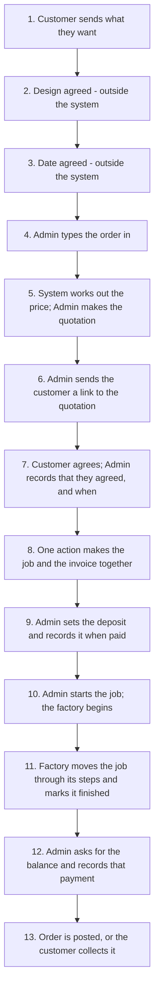
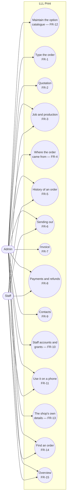

# Software Requirements Specification (SRS)

Project: LLL Print
Status: Draft. Fully rewritten against the agreed SPMP and checked against it.
It stays Draft until the shop has read it back and accepted it.
Last updated: 2026-10-05

This document does not authorise building anything on its own. See
`docs/SPMP.md` for what the current milestone covers.

## 1. Product context

### Purpose

This document says what LLL Print must do. It names who uses the system, how one
order moves through it from the customer's first message to the day it goes out,
and what the system must do at each point.

It does not say how any of it is built. That is the SDD.

| Document | Question it answers |
|---|---|
| SPMP | Why are we building the product, what is its scope, and how is the work planned? |
| SRS | Who uses the system, how does an order move through it, and what must happen? |
| SDD | How will the screens, the data and the interfaces meet these requirements? |

The problem this system solves is set out in SPMP section 1.2. In short: the shop
keeps its orders in WhatsApp and Excel today, so the same details are typed again
for the quotation, again for the invoice, and again when telling the factory what
to make. This document specifies a system where the order is typed once.

No time saving and no reduction in mistakes have been measured, and none is
claimed.

### What the system does

LLL Print is one web system for one Malaysian print shop, Three L T shirt Factory
Apparel. It keeps one record for each order.

**Admin types every order in.** The customer does not fill in a form and does not
log in. The customer sends what they want however they like, usually a WhatsApp
message, and Admin types it into the system. A customer form may be added later;
it would use the same fields, the same options and the same prices, so only the
person at the keyboard would change.

**The design is agreed outside the system.** The customer and the designer talk
until the design is settled. The system does not draw a design, discuss it or
approve it. It keeps the agreed mockup as a picture attached to the order, and
that picture may be attached at any time.

**Every order is known by its job title.** One real order is used as the example
throughout this document: **KEM PENGAKAP** — EYELAT 170gsm, 55 helai,
RM 1,734.00, due 5 October.

**The order is typed once and reused.** The same typing produces the quotation,
the invoice and what the factory makes. What was agreed stays saved, so it can be
read again months later.

**Prices are worked out and shown.** Every option that changes the price is
listed with its own arithmetic, so the customer can see how the total was
reached. A price may be zero, and a price may be less than nothing where an
option is worth less. There is no tax field, no discount field, and no automatic
price reduction for ordering more.

**Money is stated in Malaysian Ringgit everywhere**, written as RM.

LLL Print is not a design editor, a payment gateway, a courier platform or an
accounting package. Stock and materials are not tracked.

### The order journey

This is how one order moves. Steps 2 and 3 happen outside the system.

Two rules sit on that journey.

**The job never starts by itself.** Admin starts it, once the deposit is paid.
Paying the deposit makes the job ready to start; it does not start it.

**The order is normally paid in full before it goes out.** Admin may hand it over
with money still owing, but only with a reason recorded against the order.

The deposit is an amount Admin types for each order, anywhere from RM 0.00 up to
the invoice total. It is never a percentage. RM 0.00 means the job may be started
with no payment recorded first.

Nothing in this journey is blocked by the mockup picture. It may be attached at
any time, and the system never refuses an order, a quotation, a job or a handover
because no picture is attached.

### Words used in this document

| Term | Meaning in LLL Print |
|---|---|
| Customer | The person or organisation ordering printed goods. The customer does not log in |
| Contact | Saved customer details, reused on later orders |
| Job title | The name the order is known by, such as KEM PENGAKAP. The first thing typed on a new order |
| Order form | The screen where Admin types one order after the design has been agreed |
| Garment group | One garment on an order, with its own options and its own row of sizes and quantities |
| Option | One choice that can be made on an order, such as a neck, a sleeve or a size. Options come from the catalogue, are shown as buttons, and each carries its own price |
| Option catalogue | The list of options the shop offers, and what each one costs as standard. Admin maintains it |
| Price per piece | The price of the garment itself, before any option. Admin types it for each order. Nothing keeps a standard one and the system never fills it in |
| Order charge | A charge on the whole order, such as artwork setup. Admin types its name and its amount for that order. It is not in the catalogue and is never negative |
| Standard price | The price of an **option** when nothing more specific applies. There is no standard price per piece |
| Customer-specific price | A price Admin has set for one customer against an option, used instead of that option's standard price for that customer |
| One-off order price | A price Admin types over an option's resolved price, for one order only |
| Mockup | The picture of the agreed design, attached to the order. Optional, and it may be attached at any time |
| Quotation | The saved record of the order and its worked-out price, which Admin sends to the customer as a link |
| Validity date | The date after which the quotation's prices are no longer offered |
| Job | The record the factory works from, created when the customer agrees |
| Invoice | The record of what the customer owes, created at the same moment as the job |
| Deposit | The amount Admin requires before the job may be started, typed per order from RM 0.00 up to the invoice total |
| Payment | One recorded receipt of money against the invoice |
| Balance | What is still owed on the invoice after the payments recorded so far |
| Refund | One recorded return of money. The money itself moves outside the system |
| Sending out | Posting the order to the customer, or the customer collecting it |
| Sen | The unit money is stored in. RM 1,734.00 is stored as 173400, so no total can drift |
| Admin | The shop owner or office staff, who may do everything |
| Staff | A factory or office account, which may only do what Admin has granted it |

### A worked example: KEM PENGAKAP

This is the shop's own order, used to show the journey end to end. The customer
sent one WhatsApp message asking for scouting camp shirts.

| Step | What happens | What the system holds afterwards |
|---|---|---|
| 1 | The customer messages Admin. The design is agreed with the designer, and 5 October is agreed as the date | Nothing yet. Both happen outside the system |
| 2 | Admin opens a new order, types the job title KEM PENGAKAP, chooses the customer — adding them if they are new — and sets 5 October as the date wanted | One order, named, with a customer, and no prices yet |
| 3 | Admin sets the order's specifications — EYELAT 170gsm as the material | The specifications apply to every garment on the order |
| 4 | Admin adds five garment groups, choosing the neck and sleeve for each from the option buttons | Five garment groups. Each button shows the price it carries |
| 5 | Admin types the sizes and quantities under each garment group | Twenty size entries, 55 helai in total |
| 6 | Admin types the price per piece — RM 28.00 — and the system works the rest out as it goes | A running total. The price per piece shows as its own line, 55 helai at RM 28.00 for RM 1,540.00, and then every priced option with its own arithmetic. The total is RM 1,734.00 |
| 7 | Admin makes the quotation and sends the customer its link | One saved quotation with a validity date. The customer opens the link and reads it without logging in |
| 8 | The customer agrees. Admin records that they agreed, and when | The quotation is marked agreed, with the date |
| 9 | Admin presses one action | A job and an invoice for RM 1,734.00, both created together from the same order. Nothing is typed again |
| 10 | Admin sets the deposit for this order and records it when the customer pays | The invoice shows what has been paid and what is still owed |
| 11 | Admin starts the job | The factory sees it. It did not start on its own when the deposit was paid |
| 12 | The factory moves the job through its steps on a phone and marks it finished | Each step records who did it and when |
| 13 | Admin records the balance payment, then the order is posted or collected | The order is closed, and everything that happened to it can be read back |

The mockup picture may be attached at any point from step 2 onwards, and its
absence never stops any of these steps.

### Who uses the system

| Role | What they do |
|---|---|
| Admin | Types orders, makes quotations, records that the customer agreed, creates jobs and invoices, sets deposits, records payments, starts jobs, approves a handover with money owing, maintains the option catalogue and its prices, and manages Staff accounts |
| Staff | Works on what Admin has granted. In the factory this is opening a released job on a phone, moving it through its steps and marking it finished |

The customer is not a user. They never log in. They receive a link to their
quotation, which they can read without an account.

**A new Staff account starts with nothing granted.** Admin then ticks the
business actions that account may perform — for example starting a job, recording
a payment, or approving a handover with money still owing. The grants name real
business actions rather than generic add, edit and delete, because the shop cares
which action was taken, not which record was touched. Managing Staff accounts and
their grants is Admin's alone.

## 2. In scope

These are listed in the order the system is built, which is the order of the
modules in SPMP section 3.1. They match the scope in SPMP section 1.5.1.

1. **The option catalogue** — Admin maintains the options the shop offers and
   what each one costs as standard: the necks, the sleeves, the sizes, the
   materials, the printing methods, the print locations, and names and numbers.
   Admin decides which are available and what each is worth, and an option may
   be worth nothing or worth less than nothing. No choice on the order form can
   be made unless it is in the catalogue first. The two figures that are typed
   instead of chosen are the price per piece and an order charge such as artwork
   setup. See FR-12, FR-1.4a and FR-1.6a.
2. **One order form, typed by Admin** — after the design has been agreed outside
   the system. The customer does not fill it in and does not log in.
3. **The order in three levels** — one set of specifications for the whole order,
   then the garment groups, then the sizes and quantities under each group. The
   specifications are typed once and apply to every garment. Neck, sleeve and
   size are chosen from the catalogue as buttons, never typed.
4. **Pasting the customer's message** — Admin pastes the message they were sent
   and the system proposes the order's material, its due date and its garment
   groups with their sizes and quantities. Every proposed value is a draft that
   Admin reviews and may change before it is applied. See FR-1.14.
5. **The mockup attached to the order** — one picture of the agreed design. It
   may be attached at any time and nothing waits for it.
6. **The price worked out and shown** — the price per piece Admin typed, and
   every option that affects the price, each shown with its own arithmetic, with
   a running total building as Admin types.
7. **A quotation with a validity date** — the saved record of the order and its
   price, with the date after which those prices are no longer offered.
8. **A quotation document with a private link** — Admin sends the link to the
   customer, who opens and reads it without an account. The system does not send
   the message itself.
9. **Recording that the customer agreed** — Admin records that the customer said
   yes, and when.
10. **One action that makes the job and the invoice together** — from the agreed
    quotation, with nothing typed again.
11. **Deposit and payment records** — Admin sets the deposit for the order from
    RM 0.00 up to the invoice total and records each payment against the invoice.
    Meeting the deposit makes the job ready to be started; it does not start it.
12. **Production steps, and the factory on a phone** — the shop sets its own
    production steps, which differ by printing method. Admin starts the job, and
    factory Staff move it through its steps and mark it finished.
13. **Shipping or self-collection** — Admin records which one, and records that
    the order was posted or collected. Shipping takes the recipient's name,
    phone, address, postcode and state, and its charge is part of the price.
    Self-collection uses the shop's own address and has no charge. Courier name
    and tracking reference are optional.
14. **Contacts, and a history of what happened to each order** — customer details
    reused on later orders, and a record of the events on each order.
15. **Company details** — the shop's name, registration number, logo, address,
    phone and email, kept once and printed on every document. See FR-13.
16. **Search on every list** — by order number, customer name and job title.
    See FR-14.
17. **Filtering by date range and by status.** See FR-14.
18. **The Overview screen** — what needs attention and what is running late, with
    the next action shown on each one. See FR-15.
19. **Correcting what has already been issued** — an issued invoice, a confirmed
    payment or a cancelled order is never quietly edited. It is replaced, voided
    or refunded, and what was there before stays readable.
20. **Staff accounts and what each may do** — Admin creates Staff accounts and
    ticks the business actions each one may perform. A new account starts with
    nothing granted. Staff cannot manage accounts or change their own grants.
21. **Works on office desktop, supervisor tablet and factory phone** — one
    system, laid out to suit each.

Every record in every one of these names the shop it belongs to, and every search
includes it. See SPMP section 2.2.

## 3. Out of scope

**Not built now, and intended for later:**

- The customer filling in their own order form, and the private link, expiry and
  frozen prices that would go with it. The form, its options and its prices are
  the same either way, so only the person at the keyboard would change.
- A public shop page that anyone can find and order from.
- Serving more than one print shop. Every record already names its shop, so this
  is later rather than never. See SPMP section 1.5.1.

**Not built, and not intended:**

- Creating, discussing or approving the design inside the system.
- Customer accounts. The customer never logs in.
- A QR code for the customer to follow their own order.
- Taking payment online, or connecting to a payment provider. Money moves outside
  the system and is recorded in it.
- Booking a courier, connecting to one, or tracking a parcel live. A tracking
  reference may be typed in by hand.
- Stock, materials, and working out what a job consumes.
- Tax, discounts, and prices that fall automatically when more is ordered. A
  price that comes down is an option worth less, not a discount off the bottom.
- Full accounting, tax filing and formal credit notes.
- Connecting to WhatsApp or any other messaging service. Pasting message text in
  by hand is not a connection, and it is in scope as item 4.
- Reading a photograph or a screenshot of an order. The reader takes pasted text
  only.
- Using AI to create a design, to set a price, or to take any decision without
  Admin. Reading a pasted message into draft rows that Admin reviews is in scope
  as item 4.
- Sending reminders or chasing payment automatically. The Overview screen shows
  what is late; a person decides what to do about it.
- Scanning with a camera.
- Charts and analytics beyond the counters and lists on the Overview screen.
- A form builder that lets anyone invent new fields. Order choices come from the
  option catalogue in item 1.

**One thing that is not excluded, only not finished.** Protecting the quotation
link, controlling what may be uploaded, logging staff in and enforcing what each
may do are all in scope and all must be designed and working before any real
customer data is used. They are listed here so nobody reads their absence from a
screen as a decision.

## 4. Functional requirements

### Who does what

Admin and Staff are the only actors. Admin may do everything. Staff may do only
what Admin has ticked for that account, so the Staff lines above are what a
Staff account **may** be granted, not what every Staff account has.

**The customer is not an actor and is deliberately absent from the diagram.**
They do not log in, they do not fill in a form, and they perform no use case.
The only thing that reaches them is the link to their quotation, which Admin
sends and which they read without an account. That is Admin's use case, not
theirs.

### Use case summary

| What | Who does it | Requirement |
|---|---|---|
| Maintain the option catalogue and its standard prices | Admin | FR-12 |
| Type the order and see its price | Admin | FR-1 |
| Make the quotation, send its link, record that the customer agreed, turn it into a job and an invoice | Admin | FR-2 |
| Start the job; move it through its production steps | Admin; Staff when granted | FR-3 |
| Record where the order came from | Admin | FR-4 |
| Read the history of an order | Admin; Staff when granted | FR-5 |
| Record that the order was posted or collected | Admin; Staff when granted | FR-6 |
| Issue and correct an invoice | Admin | FR-7 |
| Record payments and refunds | Admin; Staff when granted | FR-8 |
| Keep customer details | Admin | FR-9 |
| Create Staff accounts and tick what each may do | Admin | FR-10 |
| Use the system on a phone | Admin; Staff when granted | FR-11 |
| Keep the shop's own details, printed on every document | Admin | FR-13 |
| Find an order by number, customer or job title, and filter a list | Admin; Staff when granted | FR-14 |
| Read what needs attention across every order | Admin; Staff when granted | FR-15 |

Whether a Staff account's grants are actually enforced, rather than only hidden
on screen, is covered in section 5.

### FR-1 The order form

- FR-1.1 Admin shall type every order. The system shall not offer an order form
  to a customer, and a customer shall not be able to log in. If a customer form
  is added later it shall use the same fields, the same options and the same
  prices as this one.
- FR-1.2 The first thing typed on a new order shall be its job title, which is
  the name the order is known by everywhere afterwards. An order shall also
  carry the customer and the date the customer wants it by.
- FR-1.3 The order shall be held in three levels:
  1. **Order specifications**, typed once and applying to every garment on the
     order — the material, the printing method and the print location.
  2. **Garment groups**, one for each garment on the order, each with its own
     neck and sleeve and an optional note.
  3. **Sizes and quantities**, listed under the garment group they belong to.

  The order specifications shall never be repeated on a garment group or on a
  size. One order shall be able to hold several garment groups without the
  specifications being typed again.
- FR-1.4 Neck, sleeve, size, material, printing method and print location shall
  be chosen from the option catalogue (FR-12) and shall be shown as buttons.
  None of them shall be typed, and no value outside the catalogue shall be
  accepted. Each button shall show the price that choosing it applies.
  A note on a garment group is free text, carries no price, and is for Admin to
  read — for example `readymade`. A note on a size is free text too, and is for
  identifying one piece, such as a person's name or number.

  This clause governs those six choices. It does not govern the price per piece,
  which is typed (FR-1.4a), nor an order charge, which is typed (FR-1.6a).
- FR-1.4a Every order shall carry a **price per piece**, which Admin types. It
  is the price of the garment itself, before any option is added. On the real
  order it is RM 28.00, and 55 helai at RM 28.00 is RM 1,540.00 of the
  RM 1,734.00 total.
  - It shall be typed for each order. The system shall **not** keep a standard
    price per piece anywhere, shall not keep one for each customer, and shall
    never fill the figure in by itself.
  - It shall be zero or above. It shall be required before a quotation can be
    made (FR-1.11).
  - It shall never fall automatically because more was ordered (FR-1.9).
  - It is not an option and is not in the catalogue, so the three steps in
    FR-1.5 do not apply to it. There is nothing for them to resolve: the typed
    figure is the only figure.
- FR-1.5 The system shall work out the price of **an option** in this order:
  1. a one-off price Admin has typed for this order,
  2. a price set for this customer,
  3. the standard price from the catalogue.

  The price that results shall be shown on the option itself, so Admin can see
  what is being charged without opening anything. Admin may type a one-off price
  over it at any point before the quotation is made.

  This applies to options only. The order's price per piece is typed under
  FR-1.4a and is not resolved from anything.
- FR-1.6 Each option shall be charged either **for every piece** or **once for
  the whole order**, as the catalogue says for that option. A per-piece option
  shall be multiplied by the number of pieces it applies to.
- FR-1.6a Admin shall be able to add a **charge to the whole order** by typing
  its name and its amount — for example `Artwork setup`, RM 50.00, once for the
  order. On the real order that RM 50.00 is part of the RM 1,734.00 total.
  - An order may carry more than one. Each shall be charged either once for the
    order or for every piece, as Admin chooses (FR-1.6).
  - **Each amount shall be zero or above.** A typed charge shall never be
    negative, because a negative line typed onto an order is a reduction taken
    off the total, which FR-1.9 forbids. Where a thing is worth less it is an
    option priced below zero, chosen from the catalogue.
  - It shall be typed, not chosen. It is not added to the option catalogue, and
    typing one shall change nothing for any other order.
  - It shall be shown with its own arithmetic like every other line (FR-1.7),
    and it shall be saved on the quotation exactly as typed (FR-2.2).
  - Because the name is typed, the same charge may be spelt differently on two
    orders. The system shall not be expected to add up what was charged for one
    kind of thing across orders.
- FR-1.7 The system shall show the price building as Admin types, and shall show
  every line that affects it with its own arithmetic — what it is, how many it
  applies to, the price each, and the result. This covers the price per piece as
  its own line — `55 helai x RM 28.00 = RM 1,540.00` — and then every option. A
  total with no workings shown is not acceptable.
- FR-1.8 All money shall be held in whole sen. RM 1,734.00 is held as 173400.
  Where working out a line produces a fraction of a sen, it shall be rounded to
  the nearest sen, with a half rounded up, at that line. Lines shall then be
  added together. No money shall ever be held as a fractional number.
- FR-1.9 The system shall not provide a tax field, a discount field, or any
  price that falls automatically because more was ordered. Where a thing is
  worth less, it shall be an option with a price below zero — for example a
  child's size — and never a reduction taken off the total. An option priced at
  RM 0.00 shall still be shown at RM 0.00, so that a free option looks decided
  rather than forgotten.
- FR-1.10 Admin shall be able to save an unfinished order and come back to it.
  Its total shall be clearly marked as not yet final.
- FR-1.11 The system shall not allow a quotation to be made from an order unless
  it has a customer, a job title, a date the customer wants it by, complete order
  specifications, a typed price per piece (FR-1.4a), and at least one garment
  group holding at least one size with a quantity above zero. A mockup shall
  never be required.
- FR-1.12 Admin shall be able to attach one picture of the agreed design to the
  order.
  - It may be attached at any time — while the order is being typed, after the
    quotation has been sent, or while the job is running. Nothing shall ever be
    refused because no picture is attached.
  - The system shall accept JPG, PNG and PDF files, up to 10 MB each.
  - A file that is the wrong type or too large shall be refused, and the system
    shall say which of the two reasons applies and what is allowed. Nothing else
    typed on the order shall be lost when a file is refused.
  - Each attachment shall record who attached it and when. Attaching a new one
    shall keep the earlier ones and show the newest as current. No reason shall
    be required to replace one.
- FR-1.13 If saving fails, the system shall keep everything Admin has typed and
  show plainly what is wrong and what to do about it. Nothing typed shall be lost
  because a save failed.
- FR-1.14 Admin shall be able to paste the message the customer sent and have the
  system propose the order from it.
  - The system shall propose the order's **material** and the **date the customer
    wants it by** from the message, as well as the garment groups.
  - The proposal shall keep the grouping the message already has: one garment
    group for each garment, with its sizes and quantities underneath. It shall
    not produce one flat row for every size.
  - Every proposed value shall be a draft. Each one shall be shown for Admin to
    check, and each one shall be an option from the catalogue subject to FR-1.4,
    which Admin may change before applying it.
  - Nothing shall be priced or sent to a customer while any proposed value is
    still unchecked. Admin remains the author of the offer.
  - A word in the message that is not an option — for example `readymade` —
    shall go to the garment group's note and shall change no price.
  - Admin pastes the text by hand. The system shall not connect to a messaging
    service to fetch it, and shall not read a photograph or a screenshot.
  - If the reading fails or returns nothing usable, the system shall keep the
    pasted text on screen so Admin can type the order instead.
  - The reading service is charged for by use. The system shall have a limit on
    how much reading it may do in a month, and shall tell Admin when that limit
    is reached rather than failing silently.

### FR-2 The quotation, and turning it into a job and an invoice

- FR-2.1 A quotation shall move through these states and no others:
  **draft → sent → agreed → converted**, with **cancelled** reachable from
  draft, sent or agreed.

  | State | What it means |
  |---|---|
  | draft | Admin is still typing it. Its total is marked as not final |
  | sent | Admin has made the quotation document and sent its link to the customer |
  | agreed | Admin has recorded that the customer said yes, and when |
  | converted | The job and the invoice have been made from it |
  | cancelled | It will not go ahead. A reason is required |

- FR-2.2 Making a quotation from an order shall save the customer, the job
  title, the order specifications, every garment group with its options and
  notes, every size and quantity, the typed price per piece, the price resolved
  for each option, every typed order charge, and the totals — exactly as they
  were shown when it was made.
  Changing the option catalogue, a standard price or a customer price afterwards
  shall never alter a saved quotation.
- FR-2.3 A quotation shall carry a **validity date**, after which its prices are
  no longer offered. The system shall show plainly when a quotation has passed
  that date. Passing it shall not delete or change the quotation.
- FR-2.4 The system shall produce a quotation document and a private link to it.
  Admin sends that link to the customer, who opens and reads it without an
  account and without logging in.
  - The link shall carry a long random value that cannot be guessed from
    another order's link or from an order number.
  - The system shall not send the link itself and shall not connect to WhatsApp
    or any other messaging service. Admin copies the link and sends it.
  - The document shall show the shop's own details, the order, every priced
    option with its arithmetic, the totals and the validity date.
  - The document shall never show an internal note. A note written for Admin to
    read shall not appear on anything a customer sees.
- FR-2.5 Admin shall record that the customer agreed, with the date. There is no
  form for the customer to submit, so this record is the only thing that marks
  agreement. A quotation shall not be converted until it is recorded as agreed.
- FR-2.6 Admin may cancel a quotation from draft, sent or agreed, and shall give
  a reason. A cancelled quotation shall not be converted.
- FR-2.7 A quotation that has been sent or agreed shall not be edited in place.
  To change it, Admin makes a **new revision**, which is a fresh quotation
  carrying the earlier one's details. The earlier revision stays readable, and
  the system shall record that the newer one replaced it.
- FR-2.8 **One action shall turn an agreed quotation into a job and an invoice
  together.** Nothing shall be typed again. That action shall:
  1. **create a job** holding the customer, the job title, the order
     specifications, the garment groups, the sizes and quantities, and the due
     date;
  2. **create an invoice** for the full total, linked to that job;
  3. **leave the quotation exactly as it was.**
- FR-2.9 **The quotation shall never be turned into the job.** It shall not be
  overwritten, reused as the job record, or changed by the conversion in any
  way. After converting there shall be three records — the quotation, the job
  and the invoice — and the quotation shall still show what the customer was
  quoted, whatever happens to the job afterwards.

  This is required because the price or the quantity on a job may be corrected
  later. If the quotation and the job were one record, that correction would
  silently rewrite what the customer agreed to, and the shop could no longer
  answer what was actually quoted.
- FR-2.10 The system shall set the deposit for the order as part of the same
  action, from RM 0.00 up to the invoice total. The field shall start empty and
  shall require Admin to choose. The system shall never apply a percentage
  automatically. RM 0.00 is a valid choice and means the job may be started with
  no payment recorded first.
- FR-2.11 Converting shall not start production. The job shall be created
  awaiting release, and Admin shall release it separately under FR-3.
- FR-2.12 Converting shall apply only to the newest revision of a quotation, and
  shall happen at most once. Pressing the action again shall not create a second
  job or a second invoice. A repeat order for the same customer shall start a
  new quotation.
- FR-2.13 Every quotation, job and invoice shall stay linked to the others, so
  that from any one of them the other two can be found.

### FR-3 Job and configurable production workflow

- FR-3.1 The system shall display all jobs in one view.
- FR-3.2 Each job entry shall show its current production step, due date,
  and status.
- FR-3.3 Converting an agreed quotation (FR-2.8) shall create the job from that
  quotation's customer, job title, order specifications, garment groups, sizes,
  quantities, resolved prices, totals and notes. The quotation itself shall not
  be changed by this (FR-2.9).
- FR-3.3a Until a Job is shipped, collected or cancelled, Admin shall be able
  to edit its current operational and commercial details directly. Each save
  shall preserve the previous Job revision, record the Admin, time and changed
  fields, and leave the quotation it came from unchanged. A commercial
  edit, including a price, quantity or item change, shall update the current
  invoice as defined in FR-7.8; no customer-agreement note is required. After
  release, it shall recalculate the balance and normal fulfilment readiness but
  shall not pause or reverse production.
- FR-3.3b After production release, an Admin edit to a factory-relevant detail
  (garment, material, size quantity, printing detail or component)
  shall require Admin to select the production checkpoint to return to. The
  system shall preserve earlier step history and require that checkpoint and
  later work to be completed or reasoned-skipped again. If production was
  complete, the Job shall return to in-production status and lose fulfilment
  readiness. Changes only to delivery details, due date or price do not reopen
  production. A mockup revision remains subject to FR-3.9b.
- FR-3.4 The system shall track each job through the lifecycle: awaiting
  release → in production → production complete → shipped or collected.
  Fulfilment readiness is derived under FR-6, not a separate manual transition.
- FR-3.5 The system shall allow cancellation only from awaiting release or in
  production, and shall require a cancellation reason.
- FR-3.6 A shipped, collected or cancelled Job shall not be edited and shall not
  return to an earlier status.
- FR-3.7 Admin or a Staff account granted Manage production workflow shall
  configure the company's general production steps. The user may add, rename,
  reorder, disable or remove broad checkpoints such as printing, sewing, QC
  and packing. Detailed real-life factory instructions and method-specific
  task lists shall not be required. Workflow editing shall be available from
  the Production screen without requiring navigation to a separate page.
- FR-3.8 A workflow change shall apply automatically to unfinished jobs. The
  system shall preserve every earlier completed or skipped step in history
  even when that step is renamed, disabled or removed from current work. If a
  change creates unfinished work for a production-complete job before
  handover, the system shall return it to in-production status and remove
  readiness. Shipped or collected jobs shall remain closed and unchanged.
- FR-3.9 The job board shall display each released job's current step and the
  completion or skipped state of its step history. A Staff member's factory
  work view shall prioritise jobs whose current step has an action granted to
  that account, without requiring the Staff member to select a status or next
  step manually. Production steps shall not require Admin to assign each job
  to a named Staff member. Every Staff account granted the current-step action
  may see and perform it; the first valid action records that acting account.
  Specific workload assignment is deferred.
- FR-3.9a A Staff production-step view shall show only information needed to
  perform the current factory action: job number, due date, product
  specifications, size quantities, mockup, current-step instructions,
  essential production notes and permitted actions. It shall not expose
  customer identity/contact details, prices, invoices, payment history or
  unrestricted Admin notes unless the account has a separate applicable grant.
- FR-3.9b If the current mockup is revised after production release, the
  factory work view shall show a clear Mockup updated notice and the newest
  version. The upload shall not stop production, reopen completed steps or
  require a separate approval automatically.
- FR-3.10 A job shall start awaiting release. It shall not start production
  until its invoice exists, its deposit requirement is met, and Admin explicitly
  releases it. **A mockup shall never be required for release** (FR-1.12); the
  system shall show whether one is attached, and shall not refuse release when
  none is. Release shall put the job in production at the first current company
  step; no separate Start production action is required.
- FR-3.11 Only Admin or a Staff account granted the applicable action may
  complete, skip or return a job step. A skipped step shall be recorded as
  skipped, not completed, and shall require a short free-text skip reason.
  Returning to an earlier step requires a rework reason.
- FR-3.12 Step actions are available only while a job is in production. A
  normal completion action shall record the acting account and time, then move
  the job to its next current step automatically without requiring notes
  or another status selection. When every current step is completed or
  skipped with its required reason, the system shall mark production complete
  automatically. No separate Complete production action is required. A
  production-complete, shipped or collected job shall not reopen through a
  step action. Fulfilment readiness is calculated automatically under FR-6.
- FR-3.12a Before handover, Admin may use a separate Reopen for rework action
  on a production-complete job. Admin shall select the step to
  return to and enter a short reason. The system shall put the job back in
  production at that step, remove fulfilment readiness, preserve the earlier
  completion history and require the returned step and all following steps to
  be completed or reasoned-skipped again. Staff accounts shall not perform
  this reopening action.
- FR-3.13 Admin shall set a required deposit amount when issuing an initial
  invoice. It shall be from RM 0.00 up to the invoice total and may equal the
  full total. RM 0.00 requires no payment before production. When the amount is
  positive,
  only confirmed payments count toward meeting it; a requested or promised
  deposit shall not count.

### FR-4 Where the order came from

- FR-4.1 The order form shall provide a free-text field recording where the
  order came from, for example "WhatsApp, 28 Aug".
- FR-4.2 It is optional. Nothing shall be refused because it is empty. It is a
  note for the shop, and FR-1.11 lists what a quotation actually requires.

### FR-5 Activity history

- FR-5.1 The activity history shall record, for each event, who did it, when,
  what the action was, and what information changed.
- FR-5.2 It shall record: saving a quotation draft, sending it, recording that
  the customer agreed, making a revision, cancelling it, and converting it into
  a job and an invoice. It shall also record each Admin edit to a job, releasing
  a job, job status changes, and production steps completed, skipped or
  returned. And it shall record each payment, each voided payment, each mockup
  attached or replaced, and any Admin approval of an early handover or a reopen
  for rework.
- FR-5.3 The activity history is only as trustworthy as the login behind it. It
  shall not be presented as proof of who did what until staff login and
  server-checked permissions are working (see section 5).
- FR-5.4 It shall also record each invoice issued or replaced, each cancellation
  settlement, each refund recorded and each refund voided, with the reason and
  the records each one links to.

### FR-6 Shipping and self-collection

- FR-6.1 Admin records on the order whether it ships or is collected. The system
  shall reuse the recorded customer, items, address and that choice without any
  of them being typed again for the handover.
  The applicable Shipped or Collected action shall be available directly in
  the completed job drawer without requiring a separate fulfilment page.
- FR-6.2 Once production completion is recorded and the invoice is fully
  settled, the system shall automatically show Ready to ship or Ready for
  collection according to the recorded fulfilment method. No manual readiness
  action is required. Both conditions are required to enable handover.
- FR-6.3 Admin or a Staff account granted the corresponding action shall
  record actual handover with one Shipped or Collected action. The system shall
  show one confirmation and record the acting account and current time
  automatically. Collected shall require no additional entry. Readiness or
  payment alone shall not record handover.
- FR-6.3a Admin may exceptionally authorize Shipped or Collected handover
  before full settlement after production completion. The system shall require
  a reason, retain the unpaid balance visibly as Not paid yet, and record the
  Admin approval in activity history. This
  exception shall not be available to Staff accounts.
- FR-6.3b A Staff account granted Shipped or Collected shall see only the
  handover information needed for that action: recipient name, phone and
  shipping address, or the pickup location, plus fulfilment method and a simple
  Ready or Not paid yet indicator. This grant shall not by itself expose item
  prices, invoice contents or payment history.
- FR-6.4 Courier name and tracking/reference shall be optional for shipping;
  they shall remain collapsed under Add shipping details unless the user opens
  them. Leaving them blank shall not prevent recording shipment. Courier
  booking and live parcel tracking remain out of scope.
- FR-6.5 The job board shall show readiness or the recorded Shipped or
  Collected result. A cancelled job shall show fulfilment as not applicable,
  prevent handover and preserve its production-step history.
- FR-6.6 Admin shall set the order's shipping charge on the order form. The form
  shall show the item subtotal, the shipping charge and the grand total as they
  build. The quotation and the invoice shall reuse that charge without it being
  typed again. After converting, Admin may change it through the editable Job,
  and the current Invoice follows under FR-3.3a and FR-7.8.
- FR-6.7 Self-collection shall have no shipping charge and shall automatically
  use the company's factory address as the pickup location. Admin or Staff
  granted the applicable action may change the location for an exceptional
  order without requiring a location selection on every order.

### FR-7 Invoice issue and correction

- FR-7.1 The system shall create the first invoice together with the job, in the
  one action defined in FR-2.8.
- FR-7.2 The system shall not automatically create an invoice when a job is
  marked production-complete.
- FR-7.3 The first invoice shall be linked to the job made from the newest
  revision of the quotation. A quotation that is still draft, still only sent,
  or cancelled shall not produce an invoice — only an agreed one does
  (FR-2.5). A cancelled job shall not receive a first invoice. Replacing an
  invoice to settle a cancellation follows FR-7.11.
- FR-7.4 When an invoice is created, the system shall keep its own copy of the
  customer, the garment groups, the sizes and quantities, the resolved prices and
  the totals, exactly as they were at that moment.
- FR-7.4a Creating the first invoice shall record the deposit Admin set, within
  the bounds in FR-3.13. A commercial Job edit shall keep
  that optional amount when it is no greater than the revised invoice total;
  if it is greater, the system shall reduce it automatically to the revised
  total. A billing-only replacement shall show and confirm the required
  deposit amount again.
- FR-7.5 An issued invoice shall not be edited or deleted. It is corrected by
  replacement (FR-7.8, FR-7.9), which keeps the earlier one readable.
- FR-7.6 The system shall require each payable invoice to have a payment due
  date. The due date shall default to the invoice creation date, may be set to
  a later date, and shall not be earlier than the invoice creation date.
- FR-7.7 The system shall allow at most one active invoice per job, retaining
  all superseded invoices in the same job billing record. Receiving a deposit
  or balance payment shall not create another invoice.
- FR-7.8 When Admin saves a commercial Job edit under FR-3.3a, the system shall
  automatically create a separately numbered replacement Invoice from the
  current Job values, mark the earlier Invoice superseded and make the new
  Invoice current. The original Invoice and its Payment references shall remain
  historical; the save does not require a customer-agreement note.
- FR-7.9 For a billing-only correction not caused by a Job edit, the system
  shall show changes to billing details, lines, quantities, unit prices, due
  date and totals alongside the current Job revision. Admin shall confirm the
  correction reason. The replacement preserves earlier Invoice snapshots and
  does not rewrite the Job.
- FR-7.10 A replacement shall retain the same job and customer identity and
  shall not rewrite the job or earlier invoice snapshots. Changing the customer
  identity requires a separately scoped resolution, not reassignment of receipts.
- FR-7.11 For a cancelled job with an invoice, Admin shall explicitly confirm
  the agreed final charge and its reason/agreement note through a replacement
  invoice whose lines and totals represent that charge, including zero.
  Cancelling a job alone shall not change its billed amount.
- FR-7.12 A cancelled job with an invoice shall remain marked as requiring
  billing review until its cancellation settlement is explicitly recorded;
  an unchanged charge may be confirmed without issuing a redundant replacement.
- FR-7.13 Invoice replacement shall preserve original payment/refund links
  while applying their net amounts exactly once to the active invoice within
  the same job billing record. It shall not create fictitious receipts or refunds.

### FR-8 Recording payments and refunds (§ 2 item 11)

- FR-8.1 The system shall require the user to confirm amount and date when
  recording a payment.
- FR-8.2 The system shall not record a payment from a single, unconfirmed
  click.
- FR-8.3 The system shall show a confirmation that summarizes the payment
  amount and date before recording it.
- FR-8.3a A user granted Record payment shall open the payment action directly
  from the current job/order drawer without navigating to a separate invoice
  page. The form shall prefill the current local date and provide quick amount
  choices for the amount still needed to meet the required deposit, the full
  remaining balance, or another amount. The user may correct the actual date,
  shall select a payment method, and shall complete the confirmation required
  by FR-8.1 through FR-8.3.
- FR-8.4 The system shall represent a zero-value active invoice with no net
  receipts as non-payable, not paid. If net receipts remain, it shall show the
  refund due instead of hiding it behind the zero invoice amount.
- FR-8.5 The system shall record each payment separately with its confirmed
  amount and date.
- FR-8.6 The system shall derive the active invoice's payment state from the
  job billing record: unpaid when net received is zero and the total is positive,
  partially paid when net received is between zero and the total, and paid when
  net received equals a positive total. Excess net received shall show refund
  due; a zero total with zero net received shall show non-payable.
- FR-8.7 The system shall not allow a recorded payment to be edited or
  deleted.
- FR-8.8 The system shall allow a recorded payment to be voided only when the
  user supplies a reason.
- FR-8.9 When a payment is voided, the system shall recalculate the invoice
  payment status from the remaining effective payments and refunds in the job
  billing record, using the settlement rules below. Before Admin release, a
  void may make the deposit condition unmet and block release. After release,
  it shall not reverse or stop physical production automatically; it affects
  normal fulfilment readiness until the balance is settled or Admin uses the
  exceptional handover approval in FR-6.3a.
- FR-8.10 The system shall prevent recorded payments from exceeding the
  active invoice's remaining amount due. A later invoice reduction may create
  a refund due without invalidating historical receipts. Formal credit-note
  documents and automatic transfer/gateway refunds remain out of scope;
  manually confirmed refund records are in scope.
- FR-8.11 The system shall require each payment to record one payment method:
  cash, bank transfer, e-wallet / QR, or other.
- FR-8.12 The system shall require a short payment-method note when other is
  selected.
- FR-8.13 The system shall show the remaining balance for each payable invoice
  after effective payments and refunds are taken into account, using FR-8.19.
- FR-8.14 A payment received before production shall be recorded against the
  job's invoice using the same records and the same balance calculation as any
  later payment. Money that has been asked for or promised but not received
  shall never count.
- FR-8.15 The system shall retain the full invoice total when a deposit is
  received; it shall reduce only the remaining balance and shall not create
  a second invoice for that deposit or for the remaining balance.
- FR-8.16 The system shall require each payment amount to be positive and no
  greater than the invoice's remaining balance.
- FR-8.17 The system shall require an issued invoice and a satisfied Admin-set
  deposit requirement before a job can start production. An RM 0.00 requirement is
  satisfied without a receipt; a positive requirement is satisfied only by
  confirmed payments. Admin must still release the job explicitly. The invoice
  shall normally be fully settled before fulfilment. FR-6.3a defines the
  Admin-only unpaid-handover exception. Payment confirmation shall not advance
  production stages automatically.
- FR-8.18 Cancelling a job shall not void its invoice, erase its payments or
  record a refund. Existing balances and payment history shall remain visible
  for review; financial resolution after cancellation is a separate workflow.
- FR-8.19 The system shall calculate net received as effective payments minus
  effective refunds for the job billing record. Amount due shall be the greater
  of zero and active invoice total minus net received; refund due shall be the
  greater of zero and net received minus active invoice total.
- FR-8.20 Admin or a Staff account granted the refund action shall record a
  refund only after confirming that money was returned externally, with positive
  amount, actual date, method, reason, source payment and a transfer/receipt
  reference or cash acknowledgement note. A promise to refund shall remain a
  refund due, not a completed refund record.
- FR-8.21 A refund shall not exceed either the job's current refund due or
  the source payment's effective unrefunded amount. Refunds spanning multiple
  receipts shall use separate linked refund records.
- FR-8.22 A refund shall reference a non-voided payment in the same job/customer
  billing record. The system shall not transfer receipts between jobs or customers.
- FR-8.23 The system shall preserve posted refunds without edit/delete. A
  recording mistake may be voided with a reason and confirmation; this shall
  recalculate settlement and shall not claim money was recovered from a customer.
- FR-8.24 The system shall reject voiding a payment while it has effective
  linked refunds. Voids correct erroneous records only and shall not substitute
  for recording money actually returned.
- FR-8.25 Payment, refund, invoice-replacement and cancellation-settlement
  operations shall reject duplicate effects and stale/concurrent changes that
  would violate the same-job, active-invoice or refundable-amount rules.
- FR-8.26 Cancellation shall not apply an automatic forfeiture percentage or
  fee. The system shall record the charge agreed for that job, not decide the
  shop's commercial or legal entitlement to retain a deposit.
- FR-8.27 The system shall reject a refund date earlier than its source
  payment's actual date or later than the current local calendar date.

### FR-9 Contacts (§ 2 item 14)

- FR-9.1 The system shall keep customer details so they are reused on later
  orders instead of being typed again.
- FR-9.2 A contact shall require a name and at least one way to reach them, a
  phone number or an email address. Address and internal notes are optional.
- FR-9.3 Admin shall be able to add a customer while typing an order, without
  leaving the order form, and carry on where they left off.
- FR-9.4 Admin shall be able to correct a customer's details at any time.
  Correcting them shall **not** change the customer details already saved on
  earlier quotations, jobs or invoices. Those records keep what was true when
  they were made.
- FR-9.5 An internal note on a contact is for the shop to read. It shall never
  appear on a quotation, an invoice or anything else a customer sees.
- FR-9.6 A contact shall show the orders it has, so the history of one customer
  can be read in one place.
- FR-9.7 The system shall not send messages to contacts and shall not record
  marketing consent.

Supplier contacts are not part of this. Nothing in scope uses them: stock,
materials and what a job consumes are all out of scope (§ 3). The old
requirement distinguished customers from suppliers, and that distinction has
been removed rather than kept as a field nothing fills in.

### FR-10 Staff accounts and what each may do

- FR-10.1 Admin shall create, change and switch off Staff accounts. A new Staff
  account shall start with nothing granted at all.
- FR-10.2 Admin shall tick each action a Staff account may perform, and may
  untick it later. Each action is granted on its own. The actions include:
  seeing a released job, attaching a mockup, completing a production step,
  skipping one, returning to an earlier one, recording that an order was posted,
  recording that it was collected, recording a payment, voiding a wrong payment,
  recording a refund, and maintaining the option catalogue.

  These are named business actions, not add, edit and delete. The shop cares
  which action was taken, not which record was touched.
- FR-10.3 A grant shall never override a rule in this document. A Staff account
  with every action ticked still cannot edit an issued invoice, change a
  historical record, or start a job that has not met its deposit.
- FR-10.4 What a Staff account can see follows what it has been granted. A
  production-step grant shows the factory details needed for that step and
  nothing more — not the customer's contact details, not prices, not invoices,
  not payment history. A handover grant shows the delivery details and whether
  money is still owed, and nothing more. Seeing customer, commercial or
  financial records requires its own grant.
- FR-10.5 Managing Staff accounts and their grants is Admin's alone. A Staff
  account shall never change its own grants.
- FR-10.6 The screens shall make plain which account is signed in and what it
  may do, so nobody is surprised by a missing control.

Whether a grant is actually **enforced**, rather than only hidden on screen, is
a requirement on the server and not on the screens. See SEC-1 and SEC-3.

### FR-11 Using it on a phone

- FR-11.1 On a phone, Admin and Staff shall see only the parts of the system
  that account may use. The number of things in the navigation is not fixed.
- FR-11.2 Navigation shall never cover a field, a button or the information on
  screen.
- FR-11.3 The factory's actions shall be reachable in as few taps as possible
  from opening the system, because they are done standing up, on a phone, with
  one hand.

### FR-12 The option catalogue

No **choice** on the order form can be made unless it is in the catalogue first,
so the catalogue is built before the form and is the first thing module 1
delivers. Two figures are typed rather than chosen and are not in the catalogue:
the order's price per piece (FR-1.4a) and an order charge (FR-1.6a).

- FR-12.1 Admin shall maintain the list of options the shop offers. There shall
  be a separate list for each kind of option: **neck**, **sleeve**, **size**,
  **material**, **printing method**, **print location**, and **names and
  numbers**. The lists shall be kept apart from one another and shall never be
  merged into one list of combinations.
- FR-12.2 Each option shall carry:
  - its name, as Admin wants it shown on the button — for example `Collar Zip`;
  - its **standard price**, held in whole sen, which may be zero or below zero;
  - whether it is charged **for every piece** or **once for the whole order**;
  - whether it is currently offered.
- FR-12.3 Admin shall be able to add an option, and it shall be available on
  every order typed afterwards. Adding an option shall not require a developer
  and shall not require the system to be changed or rebuilt.
- FR-12.4 Admin shall be able to change an option's standard price. Choosing an
  option from a list shall never fix its price: the price on any one order is
  still resolved by FR-1.5, and Admin may always type a one-off price over it.
- FR-12.5 Admin shall be able to stop offering an option. An option that is no
  longer offered shall not appear on a new order, and shall not be removed from
  or changed on any order, quotation, job or invoice that already used it.
- FR-12.6 Admin shall be able to set a price for one customer against any
  option. Where one exists it is used instead of the standard price, by FR-1.5.
  The options themselves are the same for every customer; only the prices
  differ.
- FR-12.7 A quotation shall keep the option names and the prices that were shown
  when it was made. Changing the catalogue or a price afterwards shall never
  alter a quotation, invoice or job that already exists.
- FR-12.8 The catalogue and its prices belong to the shop. Each option, each
  standard price and each customer price shall name the shop it belongs to, as
  section 2 requires of every record.
- FR-12.9 Maintaining the catalogue is Admin's. A Staff account shall be able to
  do it only where Admin has granted that action, under FR-10.

### FR-13 The shop's own details (§ 2 item 15)

- FR-13.1 The system shall hold the shop's own details in one place: its name,
  its business registration number, its logo, its address, its phone number and
  its email address.
- FR-13.2 Admin shall be able to change them, and the change shall apply to
  every document made afterwards.
- FR-13.3 Every quotation and every invoice shall show these details. They shall
  never be typed on a document.
- FR-13.4 Changing the shop's details shall not alter a quotation or an invoice
  that already exists. A document keeps what was true when it was made.
- FR-13.5 These details belong to the shop, as one record, as section 2 requires
  of everything.

### FR-14 Finding an order (§ 2 items 16 and 17)

- FR-14.1 Every list shall be searchable by **order number**, **customer name**
  and **job title**. Searching for `KEM PENGAKAP` shall find that order.
- FR-14.2 Search shall not require an exact match or the right upper and lower
  case, and shall match part of a name or title.
- FR-14.3 Every list shall be filterable by **date range** and by **status**.
  Date filtering shall offer at least today, this week, this month and all
  dates.
- FR-14.4 Every list shall load a limited number of rows at a time rather than
  every record, and shall let the user ask for more. The limit is named in
  section 6 as still to be decided.
- FR-14.5 Every search and every filter shall be limited to this shop's records,
  without the user having to ask for that.
- FR-14.6 A search that finds nothing shall say so plainly, and shall say what
  was searched for, rather than showing an empty list with no explanation.
- FR-14.7 A list shall show only what the signed-in account may see, under
  FR-10.4.

### FR-15 The Overview screen (§ 2 item 18)

- FR-15.1 The system shall provide one screen that shows what needs attention
  across every order, so the state of the shop can be read in one place.
- FR-15.2 It shall group orders by what is waiting to happen to them, at least:
  - quotations sent and not yet agreed,
  - orders agreed but not yet made into a job,
  - jobs waiting for their deposit,
  - jobs waiting for Admin to start them,
  - jobs in production,
  - orders finished but not fully paid,
  - orders finished, paid, and waiting to go out.
- FR-15.3 It shall mark what is **running late**, measured against the date the
  customer wants the order by. An order past that date and not yet sent out is
  late.
- FR-15.4 Each row shall name the next action for that order and shall open that
  order when chosen. A row that says an order is late without saying what to do
  about it is not enough.
- FR-15.5 It shall show counts and lists. It shall not show graphs or charts
  (§ 3).
- FR-15.6 It shall never send a message, a reminder or a chase to a customer.
  It shows what is late; a person decides what to do (§ 3).
- FR-15.7 It shall show only orders and figures the signed-in account may see,
  under FR-10.4.

### Cross-cutting acceptance checks

#### Quotations

- Admin types the order. There is no customer form and no customer login.
- The job title is the first field, and the order is known by it everywhere
  afterwards.
- An unfinished order can be saved and come back to, with its total marked as
  not final. A quotation can only be made once the order has a customer, a job
  title, a date the customer wants it by, complete order specifications, and at
  least one garment group holding at least one size with a quantity above zero.
  Shipping additionally needs the recipient's name, phone, address, postcode and
  state.
- The material, the printing method and the print location are chosen once for
  the whole order. A garment group carries its neck, its sleeve and an optional
  note. A size carries its quantity and an optional note. Changing an order
  specification applies to every garment at once and is never typed twice.
- Neck, sleeve, size, material, printing method and print location are buttons
  drawn from the catalogue. Nothing can be typed into them, and no value outside
  the catalogue is accepted. Each button shows the price it applies.
- The order's price per piece is typed for that order. No standard price per
  piece is kept anywhere, none is kept per customer, and the system never fills
  the figure in by itself. A quotation cannot be made until it is typed.
- A charge on the whole order, such as artwork setup at RM 50.00 once, is typed
  on the order by name and amount. It is not in the catalogue and typing one
  changes nothing for any other order. **A typed charge is never negative** — a
  thing worth less is a catalogue option priced below zero, never a line typed
  onto the order, because that would be the discount FR-1.9 forbids.
- The price shown on an **option** is the one-off price if Admin typed one, then
  the customer's own price if there is one, then the standard price. Those three
  steps apply to options and not to the price per piece. There is no discount
  field and no tax field. An option worth less shows a price below zero; an
  option that is free shows RM 0.00 rather than being hidden.
- Every line is shown with its own arithmetic — what it is, how many it applies
  to, the price each, and the result. The price per piece is one such line,
  `55 helai x RM 28.00 = RM 1,540.00`, and the options follow it. Shipping adds
  the charge Admin set; self-collection adds none and uses the shop's own
  address, which Admin or a granted Staff account may change for one exceptional
  order.
- Money is held in whole sen, so no total drifts between the order, the
  quotation and the invoice.
- A mockup may be attached at any time and is never required. The newest one is
  current, earlier ones stay, each records who attached it and when, and no
  reason is needed to replace one. A file of the wrong type or over 10 MB is
  refused with the reason and what is allowed, and nothing else typed is lost.
  A mockup attached after release shows the factory that it changed, without
  stopping production or reopening a step.
- Admin pastes the customer's message and the system proposes the material, the
  due date and the garment groups with their sizes underneath — not one flat row
  per size. Every proposed value is a catalogue option Admin checks before it is
  applied, and nothing is priced or sent while anything is unchecked. A reading
  that fails keeps the pasted text on screen.
- A quotation carries a validity date and is sent as a private link the customer
  reads without an account. The system does not send it; Admin does. An internal
  note never appears on it.
- A sent or agreed quotation is never edited in place. A change is a new
  revision, and the earlier revision stays readable.
- Cancelling a quotation requires a reason, and a cancelled one cannot be
  converted.

#### Jobs and delivery

- Admin records that the customer agreed, with the date. Nothing can be
  converted before that record exists.
- One action creates the job and the invoice together from the agreed
  quotation, with nothing typed again, and **leaves the quotation exactly as it
  was**. Afterwards there are three linked records, and the quotation still
  shows what the customer was quoted however the job changes later. Pressing the
  action again creates no second job and no second invoice.
- The deposit is typed for that order, from RM 0.00 up to the invoice total. The
  field starts empty, and no percentage is ever applied automatically.
- A job starts awaiting release. It enters production only after its invoice
  exists, its deposit requirement is met, and Admin explicitly releases it.
  **A missing mockup never blocks release.** Cancellation is available only
  while awaiting release or in production and requires a reason. Shipped,
  collected and cancelled jobs cannot move back.
- Admin, or a Staff account granted it, sets the shop's production steps from
  the Production screen. A change updates unfinished jobs while keeping what was
  already completed or skipped. New unfinished work reopens a finished job that
  has not gone out; jobs already sent stay closed.
- Only Admin or a Staff account granted the action may complete, skip or return
  a step. A skip looks different from a completion and needs a reason;
  returning needs a rework reason. Both stay in the history.
- Completing a step records who and when and moves to the next one, with no note
  and no status to choose. When every step is completed or skipped with its
  reason, production is finished automatically.
- Before handover, Admin may reopen a finished job for rework by choosing the
  step to return to and giving a reason. Staff cannot. The earlier history stays
  and the returned steps must be done again.
- A finished job that is not fully paid shows that money is owed rather than
  showing ready. Once finished and settled, it shows ready to post or ready for
  collection by itself. Admin may instead approve a handover with money owing,
  with a reason recorded.
- One action records that the order went out, with who and when, from the job
  itself. Collection needs nothing more. Courier and tracking reference are
  optional and never block it. A cancelled job cannot be handed over.
- The history records every one of these — the quotation saved, sent, agreed,
  revised, cancelled and converted; each job edit, the release, each step
  action; each payment, void, mockup and Admin approval — with who, when and
  what changed.

#### Invoices and payments

- The one action that makes the job also makes its first invoice, before any
  production. Pressing it again duplicates neither. Admin sees the whole order
  and sets the deposit in the same place, in a field that starts empty; no
  percentage is applied automatically and no separate invoice page is used.
  A cancelled job gets no first invoice. Finishing production never issues one.
- Worked through on the real order: an invoice of **RM 1,734.00** with a
  **RM 700.00** deposit recorded leaves **RM 1,034.00** owing, and the job may
  be released once that RM 700.00 is actually received. A later **RM 1,034.00**
  payment settles the same invoice before the order goes out. Money that was
  promised but not received changes nothing and releases nothing.
- Cancellation after a receipt retains the invoice and payment history;
  no automatic refund, invoice void or payment deletion occurs.
- Each issued invoice retains its customer, items, quantities, prices and totals
  permanently. A commercial Job edit creates a new current invoice version;
  it does not alter the earlier issued invoice.
- A payable invoice has a due date no earlier than its creation date and shows
  its remaining balance after effective payments and refunds.
- A job cannot have two active invoices. A correction retains the superseded
  invoice and links its replacement; existing receipts count once toward the
  current balance without changing their original invoice references.
- The activity history records who, when and what for every event listed in
  FR-5.2 and FR-5.4, and does not claim to prove identity until staff login and
  server-checked permissions are working.
- A payment is not recorded until its amount and date are confirmed; a
  zero-value invoice is visibly non-payable.
- A granted user records payment from the job/order drawer. Today is prefilled;
  quick choices offer the amount needed to meet the deposit, the remaining
  balance or another amount. Confirmation creates one immutable payment and
  recalculates the release/readiness indicators without changing production.
- An active invoice shows unpaid, partially paid, paid, non-payable or refund
  due according to its total and net effective receipts after refunds.
- A recorded payment cannot be edited or deleted. A voided payment requires a
  reason, is recorded in the activity log, and recalculates the invoice status;
  a payment that would exceed the invoice total is rejected.
- Each payment records its method; selecting other requires a short note.
- Still on the real order, with RM 700.00 received: replacing the RM 1,734.00
  invoice with RM 1,500.00 leaves RM 800.00 owing. Replacing it with RM 500.00
  instead leaves RM 200.00 to be refunded, and recording that actual RM 200.00
  refund settles the RM 500.00 charge.
- Cancelling after RM 700.00 received, and confirming RM 200.00 as the charge
  agreed with the customer, leaves RM 500.00 to be refunded. Recording that
  refund, made outside the system, leaves RM 200.00 received, nothing owing and
  nothing to refund. Agreeing a charge of nothing instead requires the whole
  RM 700.00 back before it is settled.
- A refund promise does not change net receipts. Reject an excessive refund,
  wrong-job source payment, duplicate refund, stale correction and payment void
  with an effective linked refund. Preserve original invoice and job snapshots.

#### Contacts

- A contact cannot be saved without a name and at least one phone number or
  email address. Address and internal notes may be left empty.
- Admin can add a customer while typing an order and carry on where they left
  off.
- Correcting a customer's details changes what future orders use, while earlier
  quotations, jobs and invoices keep the details saved when they were made.
- An internal note on a contact never appears on anything the customer sees.

#### Staff accounts and using it on a phone

- A new Staff account can do nothing until Admin ticks actions for it. Each
  action is ticked on its own, and a Staff account can never change its own.
- A Staff account granted a production step sees the factory details for that
  step and not the customer's contact details, prices, invoices or payments.
- Every ticked action is checked again on the server, so removing a button is
  never the only thing preventing an action (SEC-1, SEC-3).
- On a phone, each account sees only what it may use, nothing covers a field or
  a button, and the factory's actions are reachable in as few taps as possible.

## 5. Non-functional requirements

### NFR-1 Working on the devices that are used

- NFR-1.1 Each screen shall work on the devices that use it. Admin's work shall
  suit an office desktop and a tablet. The factory's actions shall be built for
  a phone first.
- NFR-1.2 LLL Print shall be one responsive web application, not a desktop
  product and a separate mobile one.
- NFR-1.3 The system shall be installable on a phone, so the factory opens it
  from the home screen without a browser bar, and its screens shall open on a
  weak signal.
- NFR-1.3a The system needs a connection for every action. Reading an order and
  saving one both reach the server. When the connection is lost, the system shall
  say so plainly and shall not appear to have saved something it has not.
  Working offline and catching up later is not in this scope.
- NFR-1.4 Pinch-to-zoom shall never be disabled.
- NFR-1.5 On a phone, lists of quotations, jobs, invoices and contacts shall use
  a readable card or list layout rather than a wide table.
- NFR-1.6 On a phone, forms shall use one column, and nothing shall cover a
  field or a button.
- NFR-1.7 On a desktop or tablet, a table may be used where everything needed
  stays visible.
- NFR-1.8 Every control shall have a visible label or an accessible name, and no
  status shall be shown by colour alone.
- NFR-1.9 The factory's controls shall be large enough to hit accurately while
  standing at a machine.

### NFR-2 Language, money and time

- NFR-2.1 Money shall be shown in Malaysian Ringgit, written as RM. A dollar
  sign shall never appear.
- NFR-2.2 The language and region shall be `en-MY`.
- NFR-2.3 Times and dates shall use `Asia/Kuala_Lumpur`.
- NFR-2.4 Money shall be held in whole sen and never as a fractional number
  (FR-1.8).

### NFR-3 Keeping it maintainable

- NFR-3.1 Each feature shall keep its screens, its data access and its rules in
  separately identifiable units. Entry points shall put features together rather
  than implement them.
- NFR-3.2 Money calculations and lifecycle rules shall be testable on their own,
  without drawing a page and without starting the server.
- NFR-3.3 Screens shall reach data through a named interface, so what is behind
  it can be replaced without rewriting the screens.
- NFR-3.4 Each finished module shall name the requirements it meets and shall
  include checks of its calculations, its state changes and what it does when
  something fails.
- NFR-3.5 A price rule or an order field shall never exist in one place only.
  When one changes, it shall be checked across the order form, the quotation,
  the invoice, the factory screen and the stored records before the change is
  accepted.

### NFR-4 Keeping the shop's data safe

The screens run in a browser. The records, the logins and the files are held by a
server of our own, and every decision about who may read or write anything is
made on that server. The browser is never trusted to decide. See SPMP § 2.2.

These are targets to be met and checked **before any real customer data is
used**. They are not yet built.

| ID | Target | How it is checked |
|---|---|---|
| SEC-1 | Every request is checked on the server for who is signed in and what they are allowed to do, with nothing allowed by default | A signed-out request, and a signed-in request from an account without the grant, are both refused when sent straight to the server rather than through our screens |
| SEC-2 | The server decides which shop a request may touch, from the signed-in account. Anything the browser claims about who it is, which shop it belongs to, or what it may do is ignored | Changing a shop field, a role field or a record identifier in a request cannot reach another shop's data or perform an ungranted action |
| SEC-3 | A hidden control is never the only thing stopping an action. Every grant in FR-10.2 is checked on the server | For each granted action, an account without that grant is refused by the server, not only by a missing button |
| SEC-4 | No secret is ever placed in the browser or committed to the repository. The key for the reading service in FR-1.14 is held on the server and the browser never sees it | Search the built screens and the repository for keys and passwords. Confirm the reading service is only ever called by the server |
| SEC-5 | A quotation link is readable without signing in, so its address must be unguessable and must expose that one quotation and nothing else | The link carries a long random value; changing it, or counting up from one order to the next, reaches nothing. It gives no way to read another order, a customer list or a price list |
| SEC-6 | Sessions use encrypted transport, expire, and can be ended. Signing out ends access. Passwords are stored hashed and never in plain text | An expired or ended session is refused. The stored password cannot be read back |
| SEC-7 | The server works out every total again from the stored lines and refuses one that does not match, and rejects any change that breaks the lifecycle in this document | Requests attempting a wrong total, an edit to an issued invoice, a change to a historical record, a skipped state, or a negative quantity are all refused |
| SEC-8 | A repeated or racing request cannot make two of something, or quietly overwrite someone else's change | Retrying the convert action, or a payment, produces one result. Two people editing the same job do not silently lose one edit |
| SEC-9 | The database enforces the relations it can express: an invoice belongs to exactly one job, a payment belongs to exactly one invoice, and neither can point at a record belonging to another shop | A write that breaks one of them is refused by the database, not only by our code |
| SEC-9a | The server enforces what no database constraint can express: converting **creates** a job and an invoice and never rewrites the quotation (FR-2.9) | Converting is tested, and the quotation is compared before and after to confirm nothing in it changed |
| SEC-10 | The shop's data can be got back. Someone has checked that restoring actually works | A restore is performed and the result compared against what was there |

The reading service in FR-1.14 is charged for by use. Its monthly limit and its
cost are still to be set, and until they are, FR-1.14's requirement that Admin is
told when the limit is reached is the only protection against a surprise bill.

## 6. Open items

This section holds only what is still undecided. Everything that was decided has
been written into the requirements above, which are the only place to read it.

### Still to be decided

| Item | What is needed | Who decides |
|---|---|---|
| The reading service's monthly limit and its cost | FR-1.14 requires that a limit exists and that Admin is told when it is reached. The number is not set | The shop, once the cost per reading is known |
| Minimum supported browser and device | Must be named and tested before real customer data is used | The developer, from what the shop actually uses |
| How much of the system is downloaded | No budget is set. The factory phone downloads it over a weak signal, so one is worth setting | The developer |
| How many rows a list loads at once | Nothing states a limit anywhere. Every list needs one, or a busy month makes a screen unusable | The developer |
| Backup, acceptable loss and time to recover | No figure is agreed. SEC-10 requires that a restore has actually been performed | The shop and the developer together |
| The order of the production module and the sending-out module | SPMP § 3.1 records this as the least settled part of the module order | The shop |

### What happens to the money when something changes

FR-7 and FR-8 are the requirements. This table is a summary of them in one place,
because these are the situations that are easiest to get wrong.

| Situation | What Admin does | What results |
|---|---|---|
| The job's price or quantity changes, nothing paid yet | Saves the job | The earlier invoice stays readable. A new current invoice shows the new total |
| The job's price or quantity changes, money already received | Saves the job, then checks the new balance | Payments stay attached to the invoice they were made against, and count once |
| A job is cancelled and it has an invoice | Confirms the charge agreed with the customer — which may be the same, less, or nothing | No money is kept or returned automatically. The current total decides what is owed or what must be refunded |
| Money must go back | Returns it outside the system, then records the refund | What was received goes down, and what must be refunded goes down |
| A payment or refund was recorded by mistake | Voids it with a reason | The original stays visible, the balances are worked out again, and the system never claims money actually moved |

Three things this deliberately does not do. It does not decide whether the shop
is entitled to keep a deposit — that is the shop's own commercial and legal
matter, and the system only records the charge agreed. It does not produce
formal credit notes or anything for tax. And it does not move money between one
customer's orders or between two customers.

A cancelled job with no invoice and nothing received has nothing to settle.

### Two limits that are rules, not preferences

- A contact or an option that is referenced by a quotation, job or invoice is
  never deleted. It may stop being offered (FR-12.5), but the record that used
  it must stay readable.
- A payment's date may be in the past. It may not be in the future.

### Decided, and where each now lives

Written here only so that a reader who remembers the earlier version knows the
decision was not dropped.

| Decision | Where it is now |
|---|---|
| One action makes the job and the invoice together, once, from the agreed quotation | FR-2.8, FR-2.12 |
| The quotation is never overwritten by that action | FR-2.9 |
| The deposit is typed per order from RM 0.00 up to the total, never a percentage | FR-2.10 |
| Production needs an invoice, a met deposit and an explicit release — and never a mockup | FR-3.10 |
| Staff accounts start with nothing granted, and Admin ticks named business actions | FR-10.1, FR-10.2 |
| Those grants must be enforced on the server, not by hiding buttons | SEC-1, SEC-3 |
| Stock, materials and what a job consumes are out of scope | § 3 |
| Admin types every order; the customer's own form comes later | FR-1.1, § 3 |

